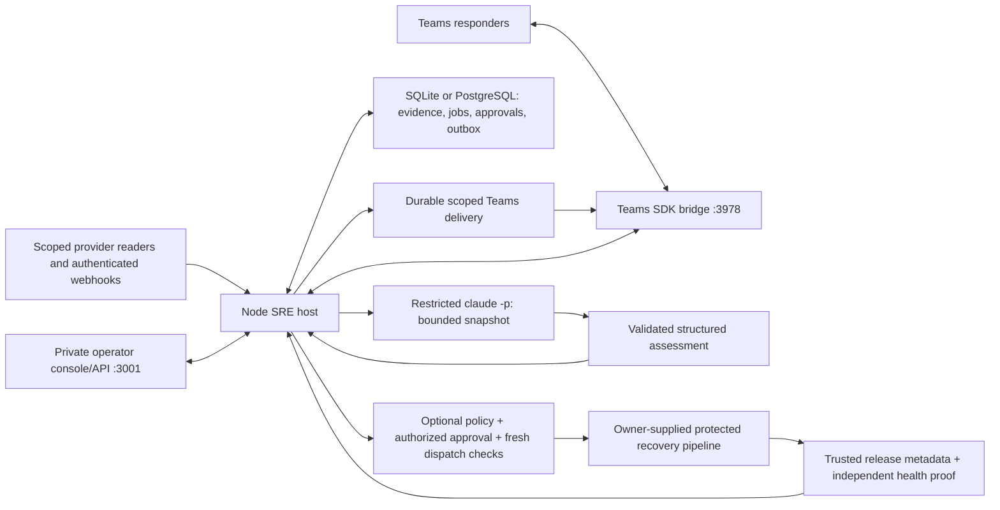

# Runtime architecture and code map

For a plain-language explanation, read [How the SRE agent works](HUMAN-GUIDE.md). Its Mermaid diagrams walk through system boundaries, one investigation, shared incident rooms, and recovery approvals. This page maps those concepts to the runtime and source files.

The persistent integration service is `src/sre/server.mjs`. Its host controls evidence collection, identity, storage, sharing, investigation jobs, and optional execution. The model returns an assessment; it does not hold deployment authority.

`initial-evidence.mjs` checks the claimed investigator slot/job lease and exact attempt when admitting ordinary connector results. Artifacts, read-derived inbox/link effects and descriptive completion receipts share a database transaction; current source inbox writes use the same native PostgreSQL service admission lock. Reads run outside that transaction. Same-incident teammate updates can enter the refreshed context; hypothesis-specific follow-up publication retains its stricter revision fence. These are current host data guards, separate from the proposed distributed dispatch design. [Read-boundary details](EVIDENCE-FOLLOWUP.md#initial-collection-ownership) include cancellation, draining and restore limits.

## Main flow

The [dispatch design](DISPATCH-DESIGN.md) is a separate proposal for multiple incident writers, shared budgets and coordinated executors. It now separates database fencing from external-effect reconciliation, includes burst/backlog arithmetic and lists distributed acceptance gates. The current runtime uses one to eight database-coordinated investigator slots with exclusive incidents; production storage remains TBD under the [current ticket](JIRA-TICKETS.md). That plan adds no dispatcher or AWS resource.

1. Configured readers poll scoped resources; authenticated webhooks normalize updates. Source identity, scope, timestamps, pagination/completeness and delivery deduplication matter independently of the content.
2. Database transactions retain evidence and work. The poller reconciles recent changes and old active incidents; a missing inventory item alone cannot close an incident. Separate source states remain distinct when correlated into one investigation.
3. A leased worker reads a bounded incident snapshot, including code/change context, telemetry and attributed responder reports. Rules are an offline known-defect fixture; Claude is the connected reasoning path. Host validation and current revision/lease checks control assessment publication.
4. Explicitly joined, authorized Teams conversations share one incident's context. The outbox retains intent and transport evidence. A timeout can leave delivery unknown; there is no exactly-once delivery guarantee or implicit read acknowledgement.
5. Ownership snapshots inform contacts. Current audited assessments can produce immutable Markdown fix plans. Tracked PR/MR and exact-head CI observations update evidence; CI, merge and deployment remain different facts.
6. Optional recovery requires host policy, current evidence, exact current/target deployments, authorized approval, expiry checks and a separate writer. The receiving pipeline must enforce its own protected contract. Submission and recovery verification are separate states.
7. All relevant source closures and a fresh independent proof matching the deployed artifact are required to resolve an incident. Restore holds quarantine external-effect uncertainty before senders/writers resume.

## Source map

| Concern | Source |
| --- | --- |
| Runtime assembly, HTTP/API/webhook routes and loops | `src/sre/server.mjs`, `config.mjs` |
| SQLite/PostgreSQL and durable records | `src/sre/database.mjs`, `store.mjs`, `question-requests.mjs` |
| Provider REST/MCP readers, credentials, retry coordination | `src/sre/connectors.mjs`, `servicenow-mcp.mjs`, `http-client.mjs`, `credentials.mjs`, `provider-retry.mjs` |
| Polling, normalization, source lifecycle and scope | `src/sre/poller.mjs`, `log-read-receipt.mjs`, `normalize.mjs`, `source-state.mjs`, `poll-scope.mjs` |
| Investigations and bounded model context | `src/sre/worker.mjs`, `reasoner.mjs`, `claude-reasoner.mjs`, `claude-config.mjs`, `model-context.mjs` |
| Teams identity/routing, delivery, coordination and handoffs | `src/sre/teams.mjs`, `teams-access.mjs`, `teams-routing.mjs`, `teams-outbox.mjs`, `collaboration.mjs`, `work-handoffs.mjs` |
| Ownership, plans, local QA and change history | `src/sre/casework.mjs`, `qa-approval.mjs`, `change-read.mjs`, `change-associations.mjs`, `change-timeline.mjs`, `ci-observations.mjs`, `ci-history-window.mjs`, `change-observation-notices.mjs` |
| Telemetry groups, log triggers and analytic checks | `src/sre/log-detection.mjs`, `log-admission.mjs`, `log-observation.mjs`, `signal-digest.mjs`, `comparison-window.mjs`, `monitors.mjs`, `analytic-risk.mjs`, `rule-attribution.mjs` |
| Noisy Grail reads, durable log pages, sample selection and immutable source priority | `src/sre/dynatrace-log-investigation.mjs`, `log-triage.mjs`, `source-evidence.mjs` |
| Recovery policy, submission, receipts and no-change outcomes | `src/sre/rollback.mjs`, `workflow-contract.mjs`, `submission.mjs`, `rollback-result.mjs`, `deployments.mjs` |
| Health, restoration, offline transfer and delivery review | `src/sre/operations.mjs`, `recovery.mjs`, `restore-recovery.mjs`, `database-transfer.mjs`, `delivery-inspections.mjs` |
| Browser console | `src/sre-web/` |
| Offline fixtures and reproducible verification | `fixtures/`, `scripts/`, `tests/` |

## Processes and ports

| Command | Default endpoint | Purpose |
| --- | --- | --- |
| `pnpm sre:dev` | `127.0.0.1:3010` | Unseeded Claude development runtime; approved connected profiles retain port 3001 |
| `pnpm sre:lab` | `127.0.0.1:3001` | Explicit offline rules fixture console |
| Same runtime with Teams enabled | Port `3978`, `/api/messages` | Teams SDK activity endpoint; `off`, local `playground`, or authenticated `live` |
| `pnpm dev` | `127.0.0.1:3000` | Original synthetic auction website/API/test harness |
| `pnpm sre:trial:demo` | `127.0.0.1:3002` | Synthetic ServiceNow MCP and collaboration demo; rules by default |
| `pnpm sre:rehearsal` | `127.0.0.1:3004` | Separate persisted synthetic multi-team casework rehearsal |

The optional Eve agent is a legacy alternative configured separately. It is not needed for the Claude path. Database jobs are this runtime's queue; the original SQS adapter does not make SQS a deployment dependency. [Dispatch design](DISPATCH-DESIGN.md) is a proposal, not an implemented distributed dispatcher.

## Extend at the host boundary

Adapt approved schemas and identities through connector/configuration boundaries, preserving completeness and scope. Add an ownership importer against its existing authenticated snapshot contract. Put any new executor in a separately reviewed isolation boundary; the trusted local auction QA fixture is not that boundary. Keep actual release/health verification with the application and deployment owners.

Do not replace SQL coordination with process-local state, put writer credentials into the model process, promote responder claims into independent verification, or infer deployment from source/CI timestamps. The implementation and tests establish detailed contracts; [the handoff](ALLY-HANDOFF.md) and [integration checklist](ALLY-INTEGRATION-CHECKLIST.md) identify what remains external.

## Claude development iteration

The [Claude development path](CLAUDE-AGENT-DEVELOPMENT.md) uses bounded NDJSON progress, general immutable source excerpts, validated candidate source locations/specifications and host-owned selected Teams messages. `agent-investigation.mjs`, `source-evidence.mjs`, `claude-stream.mjs` and `question-batch.mjs` implement these boundaries. SQL retains original questions and bounded batches, with durable last-served scheduling across incidents and per-room candidate ranking/checkpoints within an incident. Batching respects retry eligibility. Configured incident audiences may contain up to 32 rooms; larger context summaries retain identities with explicit detail omissions. [Sustained group evaluation](SUSTAINED-GROUP-EVALUATION.md) exercises these boundaries with the actual model separately from live transport acceptance.

`investigation-scheduler.mjs` admits one to eight investigators database-wide, with one active job per incident. `investigationConcurrency` defaults to one; the actual-Claude development profile explicitly selects four. Short SQL transactions serialize claims and account holds; expiring slot/job leases fence progress, heartbeat, publication and failure writes. The first admission persists capacity, leaving a schema-only database empty for offline import. Differently configured old processes fail admission after an idle capacity change. Stop active investigators before changing capacity, and stop older binaries before this rollout. `investigation-pool.mjs` refills free slots independently of a slow incident. No model or connector call holds the admission transaction. Scope, retry deadlines, revision fences and action approvals remain separate checks.

Model-selected proactive notices retain per-incident/room fingerprints of queued text and structured judgments/host observations. An unchanged structured judgment, wording-only summary change or identical queued text does not produce another proactive delivery. Full explanations remain in assessment history. Every explicit question room, including persisted batch members, and required thread destination gets a queued reply, using the full assessment when absent from the model's four custom selections. Source findings, remediation and the issue specification therefore remain available to those requesting rooms. Destination authorization and incident binding are checked inside publication, including for a suppressed duplicate. These checkpoints mean queued, not delivered; restoration retains their uncertainty rather than rearming a broadcast.

`investigation-budget.mjs` supplies the same model timeout plus collection/persistence allowance to the worker and operational tick monitor. The monitor adds ten seconds of grace and respects a larger configured threshold; command, polling and delivery thresholds remain separate. `evidence-completeness.mjs` applies known source/window/digest omissions to generation and host confidence validation. It constrains confidence without inferring a diagnosis or complete visibility.

`question-batch-budget.mjs` bounds new model batches to 32 requests and 32 KiB of serialized UTF-8 data, independently of the incident snapshot. Fair SQL selection leaves questions that do not fit pending and unmodified. The worker passes the persisted host-owned batch version to the reasoner: existing eight-request payloads retain their legacy bounds across upgrade/retry, while new version-2 batches use the strict byte limit. Stop older investigator binaries before rollout. No batch mixes incidents or changes room authority.

`request-freshness.mjs` coordinates stale direct/required-reply work through SQL. A per-incident checkpoint stores an indexed readiness time and fixed sixty-second deadline. Accepted intake extends the five-second settling interval up to that deadline; duplicate replays and source timestamps do not. While settling, new update jobs cannot bypass the waiting parent. The request can recover its previous last-served timestamp once, preserving first-pass precedence for unserved incidents; later stale turns use ordinary fairness. Per-request scheduling checkpoints leave the original job payload and request batch unchanged across retry. Transport retry deadlines, account/restore holds, exclusive leases and current-revision publication fences remain intact. Restore retains scheduling positions, per-room fairness and settling gates as historical queue metadata, with no health or action authority. Stop older investigators before rollout.

The [Dynatrace investigation path](DYNATRACE-INVESTIGATION.md) queries structured aggregates, priority records and a broad baseline within a fixed budget. The worker gathers and reduces logs before immutable source reads, preserving redacted raw pages separately from derived samples. Selection is generic data reduction; Claude supplies the causal hypothesis and read-only remediation/specification. Counts, source excerpts and recovery proposals retain independent coverage and authority limits.

The bounded snapshot reserves 8 KB for paged-log query manifests independently of the grouped-sample telemetry budget, within the existing 160 KB total. Raw-page IDs are projected out with explicit omission counts. Original pages/manifests remain in SQL. Query coverage, incompleteness and supplied auxiliary observations can therefore survive sample saturation without being promoted to verified health or independent derived corroboration. The larger-log regression and actual-model investigation exposed this need; a small fixture alone did not.

The model projection shares identical batch-wide triage coverage/interpretation once, retaining the selected source samples and strata. Claude and the explicit Codex evaluator receive shorter snapshot-scoped citation aliases in both input and generation schema; `model-citations.mjs` restores original evidence IDs before the existing host validators and persistence. Immutable source, deployment and room identities are unchanged. Generation and host shape checks require remediation. Bounded review projection also retains the discovered PR/MR number so casework can follow later heads; that association does not establish deployment or cause.

`model-quota.mjs` persists host-parsed account usage caps under the short admission transaction lock. One database has one configured investigator account. A cap preserves pending requests and blocks further claims across incidents, including after restart. Already admitted calls can finish; simultaneous cap responses retain the same hold ID and each job's ordinary attempt budget. The console and authenticated local/API endpoint can release the exact reviewed hold with an audited reason; Teams reports and model output cannot do so. A date-free provider reset label remains guidance. Restore preparation retains account holds and scheduler policy. Ordinary transport retries, lease fencing and incident revision checks are unchanged.

`scripts/lib/codex-evaluation-reasoner.mjs` is an explicit local evaluation alternative using the official Codex CLI's existing ChatGPT login. It is absent from production configuration and never an automatic fallback. The version-verified disabled execution host, filtered environment, ephemeral subprocess, bounded stdin/output and host validators preserve the investigation boundary. Its analysis and reports say `codex`; Claude results remain separate. The group workload pins provider identity and actual/test-double classification across resume.

The earlier [multi-incident workload](DYNATRACE-MULTI-INCIDENT-EVALUATION.md) exercises the single-slot configuration with several open incidents and a bounded question burst. Operation/release diversity protects low-severity witnesses from severe noise. Structured problem operations prioritize safe source references; up to two of the existing four source slots can read referenced files outside a complete diff, marked unchanged. The newer sustained workload separately exercises four slots; action authority and durable publication fencing remain unchanged.

Restore state is also exposed as a descriptive console summary. Optional question/Teams receipt summaries are read in the ingestion transaction; metadata cannot authorize release, sending or execution. The browser keeps an observed hold until a fresh read confirms release and leaves stored tickets/history accessible. Backend restore, authorization, revision and approval checks remain authoritative. No new release HTTP endpoint, schema, dispatcher or worker concurrency is introduced.

## Bounded deployment ledger selection

Deployment context now reserves native identities before counting repeated deliveries. The mapped service/environment and, for local simulations, an unambiguous runtime-problem run are selected before the window. Explicitly different simulation runs are excluded; unlabelled service-level release observations remain visible. Malformed or conflicting run markers make the selected history uncertain rather than choosing a convenient run. Production selection does not use simulation markers.

The shared SQLite/PostgreSQL query reserves latest successful/unsettled identities, the successful pair at incident start and recent valid historical health witnesses before filling remaining recent identities. Bounds are 50 identities, 20 semantic versions per identity and 200 returned facts. Repeated transport notes do not consume these version slots. Original source events, delivery rows and times remain stored. Selected projections are checked against their immutable source, hash and configured scope; a source/query failure returns storage unavailability. The query still examines stored service history: these functional bounds are not a production query-cost or throughput guarantee.

Omitted versions of a selected identity, omitted tied current identities, malformed identity metadata or ambiguous simulation scope cannot certify a settled deployment. Retained SHA/artifact contradictions remain sticky across the identity. Equal-time conflicting status observations remain uncertain until a strictly newer status arrives. The same selector is used inside independent recovery and terminal no-change verification transactions, so a crowded display window cannot silently erase a safety blocker. No schema/table or approval boundary changes.

Worker code collection filters observations to incident time before collapsing native identity versions. Digest/model ordering preserves current, incident-start, health and unsettled witnesses within their existing byte/record budgets. `deploymentWindow` describes stored coverage and limitations; its roles do not establish actual running state, provider completeness, causality or independent health. The console labels these distinctions under **Stored release history**. Complete provider reconciliation and existing exact-request approval/verification checks remain necessary.

Deployment attestations are reconciled per field: health, health time, compatibility/data safety, schema, dependency/configuration/flag fingerprints and rollback request binding. Different explicit values at the same source time remain a conflict in either delivery order. The collapsed view withholds that field rather than picking a convenient value. Only a strictly newer explicit value for that field clears the conflict; status-only updates and old or same-time repeats do not. SHA/artifact identity contradictions retain their separate sticky rule.

SQL semantic versions retain JSON type and absence/null distinctions on both adapters. A string `"true"` or number `1` cannot collapse into a boolean attestation before the conflict check. Derived conflict descriptors are recomputed from validated immutable sources; provider-supplied descriptors confer no authority. Bounded conflict fields/times are projected to digest/model/UI and independently checked by recovery/no-change transactions. Rollback compatibility also requires known nonempty fingerprint strings and a nonempty schema string or nonnegative integer; equal null/malformed values remain unknown. Health proof times must be integer epoch milliseconds.

## Reported incident log scope

For a host `log-monitor:<rule>:<scope-hash>` incident, the digest validates its latest retained monitor observation against the existing environment/region/full-release hash and incident binding. The reference is reported impact scope, with its original source time and evidence ID. Ticket text, responder prose, arbitrary log hints and a different incident cannot supply that reference. A newer malformed reference cannot fall back to an older convenient one. Missing/window-limited/future or malformed scope stays unverified.

Each log group is labelled as matching, different or unknown relative to that reference. Missing/wrong-typed or contradictory aliases remain unknown; mixed metadata in one normalized signature keeps that uncertainty in either order. Matching/unknown severe samples precede severe samples from another reported scope, while all original records remain retained. The 240-candidate, 80-evidence, 2,000-record and 12-group limits remain unchanged. Counts expose different-scope groups and omissions; no omission or scope mismatch establishes completeness, independence, cause or recovery.

Rules retain other-scope failures as unresolved dependency/request alternatives, including the same error code on the same release in another region. Unknown failure scope also prevents a scoped causal conclusion. This is evidence organization, not routing, an access boundary or automatic incident merging. Native alert/lifecycle identities and explicitly joined conversation bindings continue governing incident and responder separation. Model transport retains the descriptor/labels within existing budgets and removes a scope citation when its source evidence is outside the final snapshot.

### Repetition pressure before the candidate window

The shared SQLite/PostgreSQL candidate query reserves distinct log snapshot families before filling the 240-row window with recent repetitions. A family uses the set of record patterns in a page of at most 200 records. Record order, repeated copies, observation times and scalar request/trace IDs do not consume separate family lanes; only explicit IDs of at least eight characters are replaced in message strings. Other record fields, types, missing/null distinctions, scope aliases and message numbers remain significant. Recognized completeness and sampling flags also remain distinct. The 80-evidence selector uses the same distinctions, so a complete page cannot silently replace a partial receipt or a conflicting alias.

These are selection families, not observation identity, event deduplication or failure counts. Every raw row remains retained. Different sources/kinds keep separate lanes, code comparisons retain their independent reservations, and responder windows are unchanged. Pages larger than 200 records keep individual lanes; arbitrary nested object formatting may create extra SQLite lanes. More distinct families than the candidate/group budgets can still omit useful evidence. Source-window, record, group and model limits remain explicit; no selection improvement certifies completeness, causality or health.

The query derives families from raw JSON, without trusting a supplied signature, adding a schema/index, mutating source facts or changing restore authority. Read denial or malformed stored JSON remains storage unavailability. Query cost still grows with retained history and page size. Local cost measurements do not establish enterprise throughput; an indexed projection/retention design needs separate evidence before high-volume adoption. The SQL uses the documented [PostgreSQL JSON functions](https://www.postgresql.org/docs/17/functions-json.html) and [SQLite JSON functions](https://www.sqlite.org/json1.html).

`evidence-window.mjs` ranks families within each source/kind before balancing those sources. Giving every distinct log family a global first-rank slot had allowed hundreds of different errors to evict a quiet GitLab comparison and the host monitor. The nested ranking preserves those sources through the same 240-candidate cap; the existing 80-evidence and responder selectors still apply. Distinct families within one source can exceed its share, so explicit omissions remain necessary.

The log expression parses each eligible page once into a transient materialized document (`jsonb` on both supported adapters). The ranking carries IDs and ordering fields; raw evidence is hydrated after the bounded selection, in the same SQL statement. Original text, record types and evidence identities stay stored unchanged. The query still examines retained history. These use the documented [SQLite JSONB behavior](https://www.sqlite.org/json1.html#jsonb), [SQLite materialization hints](https://www.sqlite.org/lang_with.html#materialization_hints) and [PostgreSQL materialization rules](https://www.postgresql.org/docs/17/queries-with.html#QUERIES-WITH-CTE-MATERIALIZATION); they do not provide a persisted projection or constant-cost reads.

Peer notifications also compare a host-derived, versioned descriptor of the bounded failure patterns, their reported-scope relations and coverage states. A new pattern or newly ambiguous scope can inform joined groups even when the analytic summary remains unchanged. Counts, observation times, evidence IDs and sample ordering are excluded; repeated snapshots remain quiet. Coverage uses states rather than page counts. The worker overwrites model-supplied descriptors, and publication still checks the incident revision and worker lease transactionally.

New or newly ambiguous patterns are prioritized within the existing three-sample, 11 kB brief. The descriptor and delta stay in the audited assessment JSON; no schema or routing authority changes. A legacy assessment without a descriptor establishes one baseline notice on its next review. Reopen retains that baseline, so another unchanged question does not repeat the notice. This projection is bounded by the digest and cannot announce unseen evidence or infer recovery from a disappearing sample.
## Log threshold admission

Display grouping cannot make contradictory metadata eligible for a proactive threshold. `log-admission.mjs` validates the recognized environment, region, version, error-code and severity aliases before counters are written. Contradictory values, explicit wrong types/empty values, missing candidate time/environment or an unmapped candidate code/severity are excluded. Case differences in severity normalize together. Opaque nonempty release labels can retain separate counters but do not become a full commit identity. An explicitly returned Dynatrace query field must match its configured `logField`/`logValue`; missing source fields remain an unverified contract limitation, not an invented entity/name mapping.

The existing threshold projection remains `deployment.environment`/`environment`, `cloud.region`/`region`, `service.version`/`sha`, `error.code`/`code` and `loglevel`/`level`, with an integer epoch-millisecond value or parseable string `timestamp`. Additional display aliases are consistency checks; they do not silently redefine persisted counters. Monitors remain explicit error-code catalogs with ERROR/FATAL severity. Unconfigured errors and ordinary probes do not become threshold failures or certify health. Explicitly out-of-window records are ignored rather than pinning a polling cursor forever.

A mixed page can commit its valid matching counters and open their incident with partial evidence, then raise `LOG_ADMISSION_INCOMPLETE`. The poller already retained the raw source page and records the failure while preserving its old successful cursor. A signed webhook likewise retains its immutable source event but returns an admission error; retrying the same body does not recount it. A database failure is different: the accepted counter transaction rolls back rather than reporting partial success. Reading a later clean page can restore reader freshness; it cannot resolve the incident or retroactively upgrade partial observations.

Legacy counter identities keep their existing hashes and raw representatives. Active contradictory or explicitly mismatched counters fail storage validation and remain available for operator review. Expired rolling counters can be pruned before repair; raw source/evidence records remain immutable. A changed environment/query-field mapping invalidates the in-process repair cache without renaming persisted counters. A different actual service/tenant/environment still requires a new service key and approved mapping.

This admission boundary does not change incident routing. Service-level raw logs may remain comparison/dependency context in several active cases for the same configured service. Participant reports, scoped monitor incident identities, approvals and conversation bindings retain their separate boundaries. A log observation, exclusion or recovered reader checkpoint cannot merge incidents, create code authority or establish business recovery.
### Stable log read receipts

The source inbox now admits a full redacted log receipt atomically through `SreStore.ingestLogRead`. Numeric and string source timestamps are parsed by type. An exact replay retains its first event time instead of replacing it with a moving overlap cursor. Missing source time uses the first query observation time and remains unknown as a source timestamp. PostgreSQL uses a transaction-scoped receipt advisory lock; SQLite uses its immediate transaction. Concurrent first reads with different query times cannot choose different bodies for one receipt.

Changed completeness or provider metadata is a new content-addressed receipt. Exact legacy records-only receipts retain their original ID, time, body and hash; a changed receipt gets a new identity. Stored scope, kind, timestamp and body hash are validated before replay, and corrupt history remains unavailable. Generic event and approval deduplication stay strict. Replaying old data never rewrites its historical timestamp. Upgrade reader instances together; mixed old/new consumer semantics are not verified.

The full receipt includes provider metadata after existing redaction limits. Changing query metadata can therefore add raw source facts even when record values are unchanged. Counter identities and semantic notice suppression remain separate; query cost, retention and production metadata distributions still need measurement. Empty invalid completeness and oversized/invalid reader shapes cannot advance a complete checkpoint. No schema or dispatcher is added.

## Structured log field consistency

Signal grouping now checks the same environment, region, release, error-code and severity aliases as threshold admission. Missing fields remain unknown; agreeing empty strings can describe an unclassified observation. A nonempty alias competing with an empty, wrong-typed or different value remains unverified. Severity casing is normalized; other value remapping requires an explicit source contract. Entity names, source IDs, routes and message text are separate namespaces and are not declared equivalent by this check.

Contradictory fields have no selected display value or release match. Distinct contradictory values retain separate signature groups, while exact raw repeats keep their existing observation-overlap counts. Unverified fields receive conservative display priority and explicit coverage counts, including omitted groups. Original source records, evidence, event IDs and approvals remain unchanged. These are bounded sample diagnostics, not a source-schema validator, anomaly detector or production throughput guarantee.

Rules attribution remains unknown when scanned evidence contains unverified structured fields, preserving conditional source findings and their citations. The compact peer brief, signal command, model projection, console and Markdown ticket carry the warning. Stable peer notifications suppress repeated counts and timestamps; a new uncertainty can notify joined conversations without changing their routing. Clean later pages do not erase retained contradictory observations.

A cached older likely assessment cannot create a new fix ticket while the current digest reports this uncertainty. A new automatic QA proposal and the executor preflight independently reject it, including a saved approved request at the same incident revision. This adds a host evidence check, not new approval authority or an executor. Saved tickets and assessment bodies stay immutable; request a fresh investigation and reconcile the source mapping. No schema, dispatcher, service scope or deployment permission changes.

### Generic GitLab source evidence

Opt-in source inspection collects bounded changed files at an exact comparison pair within the configured service/project. Host-validated numbered excerpts are delivered separately from ordinary comparison metadata, and optional source findings must match both retained bytes and the actual delivered lines. Conflicting recorded original bytes block location findings even if their redacted displays match. Conditional locations feed owner lookup, peer briefings and immutable Markdown tickets; they do not establish cause, a deployment or approval. No source is executed and the generic path adds no patch executor, schema or dispatcher. See [source references](SOURCE-REFERENCES.md) for budgets, restore behavior and acceptance limits.

### Error-reported source outside a comparison

An optional reviewed `logLocations` field mapping can select exact-ref files absent from the changed-file inventory. Two error-file identities lead source reads within the existing shared turn budget/cache. Persisted `source_locations` evidence retains original log IDs, indices and hashes, mapped scope, source bytes and coverage. Numbered source revalidates each reported point against its raw log parent; model transport requires the source artifact and a delivered parent. Host-derived log references cannot become model-supplied authority. Ordinary rules can surface these locations while leaving cause and deployment identity unknown. Directory/ticket/peer flows reuse their existing contracts, with repeated receipt IDs excluded from material source notices. See [log source locations](LOG-SOURCE-LOCATIONS.md).

### Host-controlled follow-up evidence

An explicit per-service opt-in permits bounded source/log proposals between reasoning invocations. The host fixes scope, shares the initial source budget, persists started/outcome receipts under the existing lease/revision/restore fences, and refreshes the bounded snapshot. Artifacts and terminal receipts are atomic; stale responses cannot bypass final publication. Unknown or partial reads stay uncertain across restart. The child has no connector tools or credentials. This adds no schema, dispatcher, concurrency or action authority. See [follow-up evidence](EVIDENCE-FOLLOWUP.md) for limits and acceptance boundaries.

### Reconstructing unpublished read outcomes

The worker rebuilds retained follow-up outcomes from a bounded, resource-fair SQL view joined to their scoped job/start/artifact records before publication. It validates identity hashes and relationships, so an artifact committed before a worker interruption can re-enter the next assessment without requiring another file read. Same-clock job metadata supplies order only where proven; otherwise conflicting outcomes remain uncertain. Coverage warnings accompany partial/unverified history. The existing final lease/revision fence, source validation and restore/action controls still apply. See [read-outcome recovery](EVIDENCE-FOLLOWUP.md#recovery-before-assessment-publication).

The optional [candidate source discovery](SOURCE-DISCOVERY.md) collector searches only a finite approved GitLab project boundary using reviewed log service/ref/filename fields. Claimed-job checkpoints atomically retain conditional source packets and their terminal receipts, fenced by lease, revision and restore state. Candidate bytes feed numbered source validation, project-qualified contact recommendations, shared briefs and immutable plans; they never populate deployment identity. This adds no dispatcher, schema or execution authority.

Optional [candidate file history](SOURCE-HISTORY.md) extends the same fenced source artifact, shared metadata cache and file budget. Host-derived before/after spans and exact parent frames feed model context and shared reports without executing source. Retained observations survive denied fresh reads with historical labels; contradictory immutable bytes or last-modifying metadata withhold history quotes. This is a source-evidence extension, not a dispatcher or deployment action.

`source-inventory.mjs` derives bounded directory observations from fenced `gitlab/source_inventory` artifacts. `gitlab_tree` uses the existing follow-up job/receipt/SQL transaction and metadata cache, without a new schema or dispatcher. Delivered project/revision pairs select the non-recursive reader; entries are navigation metadata, while actual file quotes still pass source validation. See [SOURCE-INVENTORY.md](SOURCE-INVENTORY.md) for budgets, omission labels and the controlled tree→file rehearsal.

Directory observations are reconciled across retained artifacts: compatible partial paths keep per-entry provenance, complete witnesses survive compatible subsets, and full/partial contradictions withhold navigation. SQL and model selection balance directory/project diversity ahead of repeated receipt variants. Model projection uses only delivered support artifacts while preserving host conflict guards. The existing schema, source-read budgets, worker concurrency and dispatcher boundaries are unchanged; see [SOURCE-INVENTORY.md](SOURCE-INVENTORY.md#reconcile-overlapping-observations).
### Workflow-thread reply recovery

`alert-replies.mjs` keeps a versioned checkpoint for each newly joined workflow-alert incident/thread. Signed alert admission, the original thread record and the pending reply commit in the same ingestion transaction. A successful revision-fenced assessment reads the current authorized destinations and fulfills pending replies in the same transaction as its outbox intents, including promises left behind by an exhausted job. The record points to the exact outbox row; it never certifies delivery. Queued unknown/failed sends retain the existing inspection boundary. Explicit leave and installation removal cancel unanswered promises. The original alert events, failed jobs and delivery audit remain separate records. This uses the existing database abstraction and checkpoint/outbox schema; investigator and dispatch concurrency are unchanged.

An exhausted investigation also queues one failure explanation for each still-pending, currently authorized workflow-thread promise. The failed job and these outbox intents commit together under its exact attempt/lease and the existing service admission lock. The notice contains a bounded redacted error and the existing attributed `retry` command; it does not fulfill the diagnosis promise. Later successful work can still answer that thread. Its deterministic source/thread identity coalesces repeated failures, including uncertain or discarded earlier notice sends. Invalid ancillary promise provenance suppresses that destination without blocking the failed-job audit; actual database errors roll back the transaction. Restore holds, left/uninstalled groups and changed sharing scopes cannot authorize new feedback. This is scoped operational feedback, not another retry loop or dispatcher.

Successful reply publication atomically discards matching failure notices still in `pending`, retaining their text, original time, failed job and a reason naming the replacement reply. Delivery preflight also checks the exact promise before writing a transport preparation receipt: a claim made before result commit or cancellation can be discarded there under its current delivery lease. Expired claims remain unknown. Prepared/submitted, sent, simulated, failed and unknown sends are not recalled or rewritten. This removes obsolete retry guidance from a delayed queue without claiming exactly-once delivery or business recovery; no cancellation happens merely because another investigation is queued.
### Independent log evaluation under a scope limit

`LogDetector` classifies its guard for 100 scopes as `LogScopeLimitError`, retaining the affected service/monitor identities and any independent incidents it detected. It continues through other monitors/services only for this known condition. `observe` preserves admission coverage and accepted sample identities; the poller still records failure without advancing complete progress. Storage, cache-integrity and unexpected failures retain their existing stop behavior.

The investigation loop permits its existing read-only worker and command pass to progress, then rejects with the retained scope-limit condition so operational health stays degraded. The explicit full-cycle barrier consequently does not advance into protected execution. This is isolation inside the current serial runtime; it adds no distributed dispatcher, new worker pool, permission or schema. Restore and publication fences remain authoritative. [Operations](AGENT-OPERATIONS.md#log-scope-limits).

### Bounded local QA execution

`qa-execution.mjs` bounds the host wait around the injected trusted local adapter and reserves at most one unresolved call per runtime. Cancellation does not certify that workspace changes stopped. A deadline or shutdown publishes an unknown outcome through the existing SQL request/event/outbox path; a late result is evidence only. The automatic scheduler advances the existing investigator independently while isolated QA is submitted; QA preflight/publication and protected rollback retain their serial action phase. Runtime close interrupts QA and drains both kinds of work before storage closes, without starting a following deployment phase. The pilot adapter propagates abort to its own Git/test subprocesses and writes. Plans and QA also fence a same-revision assessment change. One investigator, one action chain, approval authority and schema remain unchanged; distributed dispatch remains design-only. See [the execution contract](QA-EXECUTION.md).

### Service-scoped integration counts

`SreStore.snapshot` derives both source totals and service/source event counts from one SQL aggregate over retained events. The status API projects scoped counts only for configured services and attaches the matching count to each connection, including the `dynatraceLogs`/`dynatrace-logs` alias. The global totals retain historical services. No recent-evidence window supplies these counts, and no count changes reader-health or restore authority. The console groups by service key, escapes display metadata and treats missing or invalid counts as unavailable. This adds no schema, dependency, stored counter or dispatcher; aggregate cost still grows with retained event history.
