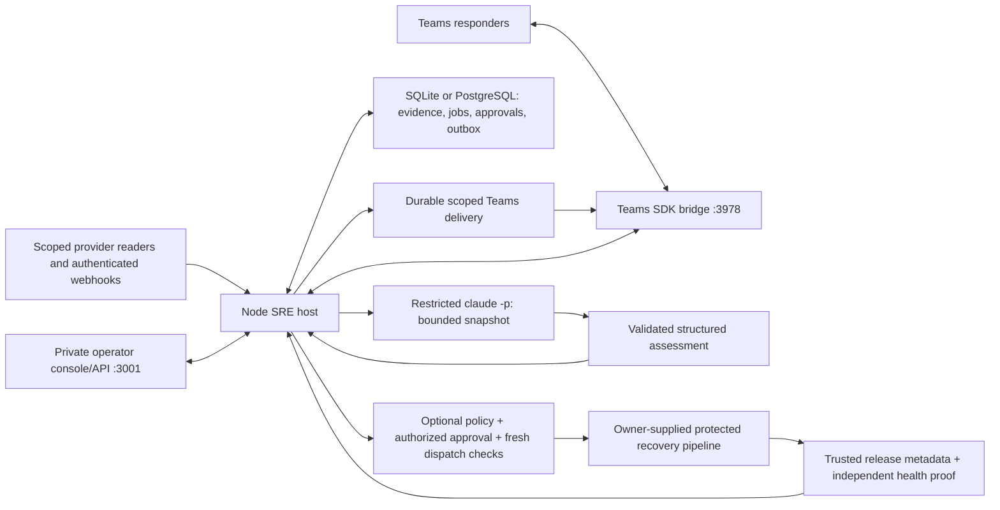

# Runtime architecture and code map

For a plain-language explanation, read [How the SRE agent works](HUMAN-GUIDE.md). Its Mermaid diagrams walk through system boundaries, one investigation, shared incident rooms, and recovery approvals. This page maps those concepts to the runtime and source files.

The persistent integration service is `src/sre/server.mjs`. Its host controls evidence collection, identity, storage, sharing, investigation jobs, and optional execution. The model returns an assessment; it does not hold deployment authority.

## Main flow

1. Configured readers poll scoped resources; authenticated webhooks normalize updates. Source identity, scope, timestamps, pagination/completeness and delivery deduplication matter independently of the content.
2. Database transactions retain evidence and work. The poller reconciles recent changes and old active incidents; a missing inventory item alone cannot close an incident. Separate source states remain distinct when correlated into one investigation.
3. A leased worker reads a bounded incident snapshot, including code/change context, telemetry and attributed responder reports. Rules are an offline known-defect fixture; Claude is the connected reasoning path. Host validation and current revision/lease checks control assessment publication.
4. Explicitly joined, authorized Teams conversations share one incident's context. The outbox retains intent and transport evidence. A timeout can leave delivery unknown; there is no exactly-once delivery guarantee or implicit read acknowledgement.
5. Ownership snapshots inform contacts. Current audited assessments can produce immutable Markdown fix plans. Tracked PR/MR and exact-head CI observations update evidence; CI, merge and deployment remain different facts.
6. Optional recovery requires host policy, current evidence, exact current/target deployments, authorized approval, expiry checks and a separate writer. The receiving pipeline must enforce its own protected contract. Submission and recovery verification are separate states.
7. All relevant source closures and a fresh independent proof matching the deployed artifact are required to resolve an incident. Restore holds quarantine external-effect uncertainty before senders/writers resume.

## Source map

| Concern | Source |
| --- | --- |
| Runtime assembly, HTTP/API/webhook routes and loops | `src/sre/server.mjs`, `config.mjs` |
| SQLite/PostgreSQL and durable records | `src/sre/database.mjs`, `store.mjs` |
| Provider REST/MCP readers, credentials, retry coordination | `src/sre/connectors.mjs`, `servicenow-mcp.mjs`, `http-client.mjs`, `credentials.mjs`, `provider-retry.mjs` |
| Polling, normalization, source lifecycle and scope | `src/sre/poller.mjs`, `normalize.mjs`, `source-state.mjs`, `poll-scope.mjs` |
| Investigations and bounded model context | `src/sre/worker.mjs`, `reasoner.mjs`, `claude-reasoner.mjs`, `claude-config.mjs`, `model-context.mjs` |
| Teams identity/routing, delivery, coordination and handoffs | `src/sre/teams.mjs`, `teams-access.mjs`, `teams-routing.mjs`, `teams-outbox.mjs`, `collaboration.mjs`, `work-handoffs.mjs` |
| Ownership, plans, local QA and change history | `src/sre/casework.mjs`, `qa-approval.mjs`, `change-read.mjs`, `change-associations.mjs`, `change-timeline.mjs`, `ci-observations.mjs` |
| Telemetry groups, log triggers and analytic checks | `src/sre/log-detection.mjs`, `signal-digest.mjs`, `monitors.mjs`, `analytic-risk.mjs`, `rule-attribution.mjs` |
| Recovery policy, submission, receipts and no-change outcomes | `src/sre/rollback.mjs`, `workflow-contract.mjs`, `submission.mjs`, `rollback-result.mjs`, `deployments.mjs` |
| Health, restoration, offline transfer and delivery review | `src/sre/operations.mjs`, `recovery.mjs`, `restore-recovery.mjs`, `database-transfer.mjs`, `delivery-inspections.mjs` |
| Browser console | `src/sre-web/` |
| Offline fixtures and reproducible verification | `fixtures/`, `scripts/`, `tests/` |

## Processes and ports

| Command | Default endpoint | Purpose |
| --- | --- | --- |
| `pnpm sre:dev` | `127.0.0.1:3001` | Persistent integration runtime and console; default offline rules |
| Same runtime with Teams enabled | Port `3978`, `/api/messages` | Teams SDK activity endpoint; `off`, local `playground`, or authenticated `live` |
| `pnpm dev` | `127.0.0.1:3000` | Original synthetic auction website/API/test harness |
| `pnpm sre:trial:demo` | `127.0.0.1:3002` | Synthetic ServiceNow MCP and collaboration demo; rules by default |
| `pnpm sre:rehearsal` | `127.0.0.1:3004` | Separate persisted synthetic multi-team casework rehearsal |

The optional Eve agent is a legacy alternative configured separately. It is not needed for the Claude path. Database jobs are this runtime's queue; the original SQS adapter does not make SQS a deployment dependency. [Dispatch design](DISPATCH-DESIGN.md) is a proposal, not an implemented distributed dispatcher.

## Extend at the host boundary

Adapt approved schemas and identities through connector/configuration boundaries, preserving completeness and scope. Add an ownership importer against its existing authenticated snapshot contract. Put any new executor in a separately reviewed isolation boundary; the trusted local auction QA fixture is not that boundary. Keep actual release/health verification with the application and deployment owners.

Do not replace SQL coordination with process-local state, put writer credentials into the model process, promote responder claims into independent verification, or infer deployment from source/CI timestamps. The implementation and tests establish detailed contracts; [the handoff](ALLY-HANDOFF.md) and [integration checklist](ALLY-INTEGRATION-CHECKLIST.md) identify what remains external.
