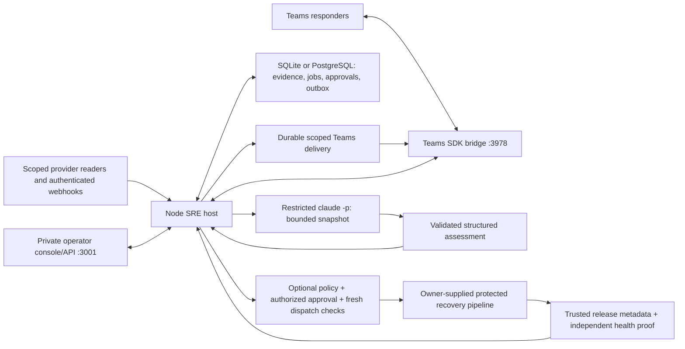

# Runtime architecture and code map

For a plain-language explanation, read [How the SRE agent works](HUMAN-GUIDE.md). Its Mermaid diagrams walk through system boundaries, one investigation, shared incident rooms, and recovery approvals. This page maps those concepts to the runtime and source files.

The persistent integration service is `src/sre/server.mjs`. Its host controls evidence collection, identity, storage, sharing, investigation jobs, and optional execution. The model returns an assessment; it does not hold deployment authority.

## Main flow

1. Configured readers poll scoped resources; authenticated webhooks normalize updates. Source identity, scope, timestamps, pagination/completeness and delivery deduplication matter independently of the content.
2. Database transactions retain evidence and work. The poller reconciles recent changes and old active incidents; a missing inventory item alone cannot close an incident. Separate source states remain distinct when correlated into one investigation.
3. A leased worker reads a bounded incident snapshot, including code/change context, telemetry and attributed responder reports. Rules are an offline known-defect fixture; Claude is the connected reasoning path. Host validation and current revision/lease checks control assessment publication.
4. Explicitly joined, authorized Teams conversations share one incident's context. The outbox retains intent and transport evidence. A timeout can leave delivery unknown; there is no exactly-once delivery guarantee or implicit read acknowledgement.
5. Ownership snapshots inform contacts. Current audited assessments can produce immutable Markdown fix plans. Tracked PR/MR and exact-head CI observations update evidence; CI, merge and deployment remain different facts.
6. Optional recovery requires host policy, current evidence, exact current/target deployments, authorized approval, expiry checks and a separate writer. The receiving pipeline must enforce its own protected contract. Submission and recovery verification are separate states.
7. All relevant source closures and a fresh independent proof matching the deployed artifact are required to resolve an incident. Restore holds quarantine external-effect uncertainty before senders/writers resume.

## Source map

| Concern | Source |
| --- | --- |
| Runtime assembly, HTTP/API/webhook routes and loops | `src/sre/server.mjs`, `config.mjs` |
| SQLite/PostgreSQL and durable records | `src/sre/database.mjs`, `store.mjs` |
| Provider REST/MCP readers, credentials, retry coordination | `src/sre/connectors.mjs`, `servicenow-mcp.mjs`, `http-client.mjs`, `credentials.mjs`, `provider-retry.mjs` |
| Polling, normalization, source lifecycle and scope | `src/sre/poller.mjs`, `normalize.mjs`, `source-state.mjs`, `poll-scope.mjs` |
| Investigations and bounded model context | `src/sre/worker.mjs`, `reasoner.mjs`, `claude-reasoner.mjs`, `claude-config.mjs`, `model-context.mjs` |
| Teams identity/routing, delivery, coordination and handoffs | `src/sre/teams.mjs`, `teams-access.mjs`, `teams-routing.mjs`, `teams-outbox.mjs`, `collaboration.mjs`, `work-handoffs.mjs` |
| Ownership, plans, local QA and change history | `src/sre/casework.mjs`, `qa-approval.mjs`, `change-read.mjs`, `change-associations.mjs`, `change-timeline.mjs`, `ci-observations.mjs`, `change-observation-notices.mjs` |
| Telemetry groups, log triggers and analytic checks | `src/sre/log-detection.mjs`, `log-observation.mjs`, `signal-digest.mjs`, `monitors.mjs`, `analytic-risk.mjs`, `rule-attribution.mjs` |
| Noisy Grail reads, durable log pages, sample selection and immutable source priority | `src/sre/dynatrace-log-investigation.mjs`, `log-triage.mjs`, `source-evidence.mjs` |
| Recovery policy, submission, receipts and no-change outcomes | `src/sre/rollback.mjs`, `workflow-contract.mjs`, `submission.mjs`, `rollback-result.mjs`, `deployments.mjs` |
| Health, restoration, offline transfer and delivery review | `src/sre/operations.mjs`, `recovery.mjs`, `restore-recovery.mjs`, `database-transfer.mjs`, `delivery-inspections.mjs` |
| Browser console | `src/sre-web/` |
| Offline fixtures and reproducible verification | `fixtures/`, `scripts/`, `tests/` |

## Processes and ports

| Command | Default endpoint | Purpose |
| --- | --- | --- |
| `pnpm sre:dev` | `127.0.0.1:3010` | Unseeded Claude development runtime; approved connected profiles retain port 3001 |
| `pnpm sre:lab` | `127.0.0.1:3001` | Explicit offline rules fixture console |
| Same runtime with Teams enabled | Port `3978`, `/api/messages` | Teams SDK activity endpoint; `off`, local `playground`, or authenticated `live` |
| `pnpm dev` | `127.0.0.1:3000` | Original synthetic auction website/API/test harness |
| `pnpm sre:trial:demo` | `127.0.0.1:3002` | Synthetic ServiceNow MCP and collaboration demo; rules by default |
| `pnpm sre:rehearsal` | `127.0.0.1:3004` | Separate persisted synthetic multi-team casework rehearsal |

The optional Eve agent is a legacy alternative configured separately. It is not needed for the Claude path. Database jobs are this runtime's queue; the original SQS adapter does not make SQS a deployment dependency. [Dispatch design](DISPATCH-DESIGN.md) is a proposal, not an implemented distributed dispatcher.

## Extend at the host boundary

Adapt approved schemas and identities through connector/configuration boundaries, preserving completeness and scope. Add an ownership importer against its existing authenticated snapshot contract. Put any new executor in a separately reviewed isolation boundary; the trusted local auction QA fixture is not that boundary. Keep actual release/health verification with the application and deployment owners.

Do not replace SQL coordination with process-local state, put writer credentials into the model process, promote responder claims into independent verification, or infer deployment from source/CI timestamps. The implementation and tests establish detailed contracts; [the handoff](ALLY-HANDOFF.md) and [integration checklist](ALLY-INTEGRATION-CHECKLIST.md) identify what remains external.

## Claude development iteration

The [Claude development path](CLAUDE-AGENT-DEVELOPMENT.md) uses bounded NDJSON progress, general immutable source excerpts, validated candidate source locations/specifications and host-owned selected Teams messages. `agent-investigation.mjs`, `source-evidence.mjs`, `claude-stream.mjs` and `question-batch.mjs` implement these boundaries. SQL retains original questions and bounded batches, with durable last-served scheduling across incidents and per-room candidate ranking/checkpoints within an incident. Batching respects retry eligibility. Configured incident audiences may contain up to 32 rooms; larger context summaries retain identities with explicit detail omissions. [Sustained group evaluation](SUSTAINED-GROUP-EVALUATION.md) exercises these boundaries with the actual model separately from live transport acceptance.

`investigation-scheduler.mjs` admits one to four investigators database-wide, with one active job per incident. `investigationConcurrency` defaults to one; the actual-Claude development profile explicitly selects four. Short SQL transactions serialize claims and account holds; expiring slot/job leases fence progress, heartbeat, publication and failure writes. The first admission persists capacity, leaving a schema-only database empty for offline import. Differently configured old processes fail admission after an idle capacity change. Stop active investigators before changing capacity, and stop older binaries before this rollout. `investigation-pool.mjs` refills free slots independently of a slow incident. No model or connector call holds the admission transaction. Scope, retry deadlines, revision fences and action approvals remain separate checks.

Model-selected proactive notices retain per-incident/room fingerprints of queued text and structured judgments/host observations. An unchanged structured judgment, wording-only summary change or identical queued text does not produce another proactive delivery. Full explanations remain in assessment history. Every explicit question room, including persisted batch members, and required thread destination gets a queued reply, using the full assessment when absent from the model's four custom selections. Source findings, remediation and the issue specification therefore remain available to those requesting rooms. Destination authorization and incident binding are checked inside publication, including for a suppressed duplicate. These checkpoints mean queued, not delivered; restoration retains their uncertainty rather than rearming a broadcast.

`investigation-budget.mjs` supplies the same model timeout plus collection/persistence allowance to the worker and operational tick monitor. The monitor adds ten seconds of grace and respects a larger configured threshold; command, polling and delivery thresholds remain separate. `evidence-completeness.mjs` applies known source/window/digest omissions to generation and host confidence validation. It constrains confidence without inferring a diagnosis or complete visibility.

`question-batch-budget.mjs` bounds new model batches to 32 requests and 32 KiB of serialized UTF-8 data, independently of the incident snapshot. Fair SQL selection leaves questions that do not fit pending and unmodified. The worker passes the persisted host-owned batch version to the reasoner: existing eight-request payloads retain their legacy bounds across upgrade/retry, while new version-2 batches use the strict byte limit. Stop older investigator binaries before rollout. No batch mixes incidents or changes room authority.

The [Dynatrace investigation path](DYNATRACE-INVESTIGATION.md) queries structured aggregates, priority records and a broad baseline within a fixed budget. The worker gathers and reduces logs before immutable source reads, preserving redacted raw pages separately from derived samples. Selection is generic data reduction; Claude supplies the causal hypothesis and read-only remediation/specification. Counts, source excerpts and recovery proposals retain independent coverage and authority limits.

The bounded snapshot reserves 8 KB for paged-log query manifests independently of the grouped-sample telemetry budget, within the existing 160 KB total. Raw-page IDs are projected out with explicit omission counts. Original pages/manifests remain in SQL. Query coverage, incompleteness and supplied auxiliary observations can therefore survive sample saturation without being promoted to verified health or independent derived corroboration. The larger-log regression and actual-model investigation exposed this need; a small fixture alone did not.

The model projection shares identical batch-wide triage coverage/interpretation once, retaining the selected source samples and strata. Claude and the explicit Codex evaluator receive shorter snapshot-scoped citation aliases in both input and generation schema; `model-citations.mjs` restores original evidence IDs before the existing host validators and persistence. Immutable source, deployment and room identities are unchanged. Generation and host shape checks require remediation. Bounded review projection also retains the discovered PR/MR number so casework can follow later heads; that association does not establish deployment or cause.

`model-quota.mjs` persists host-parsed account usage caps under the short admission transaction lock. One database has one configured investigator account. A cap preserves pending requests and blocks further claims across incidents, including after restart. Already admitted calls can finish; simultaneous cap responses retain the same hold ID and each job's ordinary attempt budget. The console and authenticated local/API endpoint can release the exact reviewed hold with an audited reason; Teams reports and model output cannot do so. A date-free provider reset label remains guidance. Restore preparation retains account holds and scheduler policy. Ordinary transport retries, lease fencing and incident revision checks are unchanged.

`scripts/lib/codex-evaluation-reasoner.mjs` is an explicit local evaluation alternative using the official Codex CLI's existing ChatGPT login. It is absent from production configuration and never an automatic fallback. The version-verified disabled execution host, filtered environment, ephemeral subprocess, bounded stdin/output and host validators preserve the investigation boundary. Its analysis and reports say `codex`; Claude results remain separate. The group workload pins provider identity and actual/test-double classification across resume.

The earlier [multi-incident workload](DYNATRACE-MULTI-INCIDENT-EVALUATION.md) exercises the single-slot configuration with several open incidents and a bounded question burst. Operation/release diversity protects low-severity witnesses from severe noise. Structured problem operations prioritize safe source references; up to two of the existing four source slots can read referenced files outside a complete diff, marked unchanged. The newer sustained workload separately exercises four slots; action authority and durable publication fencing remain unchanged.
