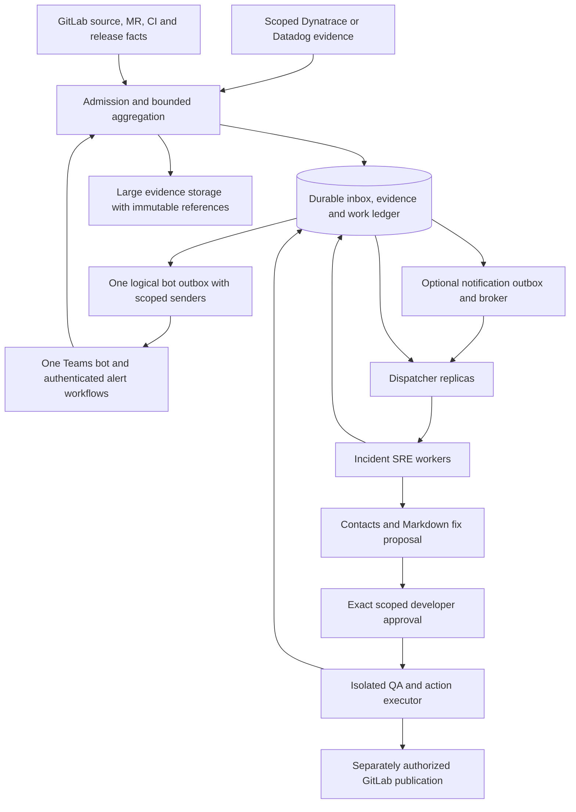

# Dispatch design for review

Status: **proposal, not implemented**. This document does not deploy AWS resources. The existing runtime keeps one durable session per incident and a relational inbox/outbox. It now supports a separately configured database-wide bound of one to four investigators, with one active job per incident and durable slot/job fencing. That bounded pool and the local QA fixture workflow do not implement the broader dispatcher, tenant budgets or specialist architecture proposed here.

## Decision in brief

People address one SRE bot. Several deterministic dispatcher replicas can schedule different incidents concurrently, while one fenced SRE writer owns each incident's published assessment. QA uses a separate isolated execution service and durable action identity. All durable facts, work, authority and delivery intent live outside dispatcher/model memory.

Start a future prototype with the existing relational work ledger and per-incident fencing, fairness and reconciliation. Add a notification broker or virtual partition ownership only after measurements justify them. Removing the global investigator lock alone would leave action ownership, context isolation and uncertain writes unresolved.

The review needs decisions on workload units, the storage contract, conversational access and the execution boundary. [Decision register](#decisions-needed-before-implementation) and [acceptance gates](#acceptance-gates) identify the evidence needed. None of the proposed distributed gates has passed merely because local prototype tests pass.

## Current implementation and the proposed boundary

| Concern | Current evidence in this repository | Proposed distributed behavior |
| --- | --- | --- |
| Investigation ownership | [`store.claim`](../src/sre/store.mjs) uses a database-wide `single-agent` lease; durable jobs/sessions exist | One fenced writer per incident; independent incidents can run concurrently |
| Healthy local QA | [`server.mjs`](../src/sre/server.mjs) allows the existing investigator to progress during submitted isolated QA, with one serial action chain | Persistent runner ownership and repository/environment conflict coordination across hosts |
| Approval/freshness | [`casework.mjs`](../src/sre/casework.mjs) checks identity, scope, revision and assessment match; [local QA](QA-EXECUTION.md) supports one generated policy fix | Generic isolated runner, exact reviewed patch/skills and separately authorized publication; no automatic deployment |
| Teams | [`bindConversation`](../src/sre/store.mjs) binds one conversation to one incident; at most eight conversations follow that incident | Stable incident/thread routing, scoped participants, one public identity and explicit ambiguity handling |
| Evidence and source history | SQLite/PostgreSQL adapters, immutable references, bounded log/code/MR/CI views | Storage technology TBD; retain atomicity, lineage, access boundaries and restore behavior at measured scale |
| External writes | Existing outbox/rollback uncertainty and local QA audit; no general remote QA publisher | Dedicated executor/reconciliation contract; SQL fencing alone cannot fence an already issued provider request |

The rules reasoner recognizes known auction fixtures. It is not evidence of general diagnostic quality. Actual Claude, Ally contracts, background conversation capture, drawings and production capacity need separate acceptance. Existing native Teams evidence does not extend an expired forwarding grant.

## Architecture

Boxes are logical responsibilities, not selected AWS products or a required number of services. The current VM can remain the host during staged adoption. Credentials, tools, access and action policy stay host controlled; the model receives a bounded snapshot. Specialist read workers can return attributed findings to the incident writer, but cannot independently approve work or broadcast competing conclusions.

## Durable intake and work protocol

The following is a proposed protocol, not a new API or schema migration:

1. Authenticate the source and resolve tenant, service/environment and approved source scope before retention. Use `(tenant, provider, native event identity, source version)` plus a content digest. Retries with the same identity/digest reuse the fact; different content at the same immutable identity is a visible conflict. Preserve observed, provider-updated and received times separately.
2. Commit accepted evidence, source progress, material incident changes, pending work and notification intent atomically. Persist the answer/reply obligation for each human question or joined alert thread; coalescing a reasoning turn must not erase those obligations. A partial page cannot advance a complete source checkpoint.
3. A broker relay publishes only committed work IDs and versions, then records its transport result. A crash after broker acceptance may cause a duplicate notification. A durable reconciliation scan repairs missing notifications. The inbox/work ledger remains authoritative.
4. A dispatcher transaction checks restore holds, fair eligibility, shared budgets and per-incident ownership. It claims a job with an attempt ID and a monotonically increasing incident fencing epoch, or confirms the same work is already durably active, completed or deferred with a reason/eligibility time. Acknowledge the broker notification only after that ledger disposition commits and deferred work is indexed for reconciliation; do not hold a queue message throughout a model turn.
5. A worker receives an immutable input manifest: incident ID/revision, assessment identity when relevant, source references/coverage, conversation audience version, permitted tools, budget and attempt/epoch. Heartbeats use database coordination time. Loss of ownership requests cancellation and prevents further publication; cancellation does not certify that a remote operation stopped.
6. Publish assessment, preserved question/alert replies and outbox intents in one transaction that rechecks job attempt, incident epoch, evidence revision, audience and restore generation. If input changed, retain historical findings where appropriate and queue a fresh review. Never call stale output current merely because its text or test result looks plausible.
7. A sender rechecks current audience and route before transmission. An obsolete unsent conclusion may be superseded by a current version while preserving its reply obligations and original audit. Unknown sends remain uncertain; they are not blindly replayed. A distinct later update has its own identity and does not erase an earlier unknown outcome.

This follows the dual-write reasoning of the [transactional outbox pattern](https://docs.aws.amazon.com/prescriptive-guidance/latest/cloud-design-patterns/transactional-outbox.html), while retaining application deduplication and reconciliation. It does not provide exactly-once external effects.

### Broker and partition choices

SQL work scanning is the initial reference design. SQS standard or FIFO are candidates for notification transport, not chosen dependencies. FIFO orders within a message group and allows different groups to progress concurrently; a hot incident still has one writer. Its visibility timeout and [five-minute deduplication interval](https://docs.aws.amazon.com/AWSSimpleQueueService/latest/SQSDeveloperGuide/using-messagededuplicationid-property.html) do not replace durable identities or action reconciliation. [FIFO behavior](https://docs.aws.amazon.com/AWSSimpleQueueService/latest/SQSDeveloperGuide/FIFO-queues-understanding-logic.html), [visibility semantics](https://docs.aws.amazon.com/AWSSimpleQueueService/latest/SQSDeveloperGuide/sqs-visibility-timeout.html).

If virtual partitions become necessary, store an explicit partition-map version and lease epoch. Reassignment increments ownership and incident fences; reconcile unfinished work across old/new mappings before retiring a mapping. Duplicate notifications across mappings are harmless only because the ledger rejects duplicate claims/publications. Partition handoff must never transfer approval authority. These application partitions are distinct from SQS's internally managed partitions. Regional quotas and actual key distribution require measurement; see [high-throughput FIFO](https://docs.aws.amazon.com/AWSSimpleQueueService/latest/SQSDeveloperGuide/high-throughput-fifo.html).

## Fairness, noise and multiple simultaneous incidents

Use eligibility and age in SQL rather than assuming broker order supplies priority. Reserve configurable capacity for human questions/new critical incidents, with weighted per-tenant and per-service shares and aging for other work. Budget provider requests by the actual shared credential/quota scope across hosts; a 429 must not be bypassed by another dispatcher. Model tokens, tool calls, wall time, concurrent runners and repository writers need separate caps. Final values and SLOs are open decisions.

For a noisy incident, retain every accepted raw reference under the approved retention policy, but coalesce material investigation generations. A new question and an unanswered alert thread remain distinct work obligations. A bounded turn yields when it reaches its budget; repeated churn cannot indefinitely starve a quiet incident. Unavailable/denied sources are visible unknowns, not an empty healthy result.

Overload must create a visible deferred state or retryable admission failure, not a successful checkpoint with silently dropped records. Version any configured source filters and record deliberate omissions. Bound intake payloads, queue storage and retention as well as inference cost; reserve capacity for control/acknowledgement work and expose coverage gaps to independent monitoring. Dispatchers must not mask saturation by resolving incidents or disabling source checks.

Aggregate source observations before model calls. Preserve rare error families, changed severity, time/scope/region/release distinctions, contradictory metadata, counts and completeness receipts. Keep log observations distinct from deployments, exact source bytes, human theories and recovery claims. Similar text, shared service or coincidental deployment does not prove common cause. Independent incidents may have a `related-to` edge without sharing private participant reports or action approval.

A future indexed projection must be versioned, reconstructible and tied to immutable source hashes. Missing/backfilling/incompatible projections expose coverage gaps; they cannot discard the only rare error or quiet code finding. Raw evidence retention and deletion policy must also account for retained citations and audit. The local pressure evidence below shows why source selection/query cost must be measured alongside queue throughput.

## One bot, many people and places

Every message needs an incident route: a joined incident thread, an explicit incident reference, or a clarification. The current one-incident-per-conversation rule remains until a reviewed multi-topic routing model exists. Do not infer which of several incidents a bare question or `yes` refers to. Keep separate threads or an explicitly selected incident; a future room covering several incidents must bind each message and reply to the correct incident/root.

The incident writer combines attributed positions, rather than treating the busiest room as truth. Preserve quiet people, conflicting explanations, task owners, duplicate work, blockers and handoffs through bounded room/person windows. Acknowledge receipt separately from agreement, completed work and verified recovery. Share material changes and required answers; suppress unchanged repeated full assessments. Tell teams what is known, who reported it, which claims conflict and the next discriminating check. Recommend a common bridge when coordination is disconnected; do not silently drop a ninth conversation or automatically invite people.

Joining an incident does not automatically authorize a union of private audiences. Each source and delivery needs an audience/policy version. Recheck access at capture, use and send; revoke future sharing after leave/uninstall/policy removal while retaining the governed audit. If teams cannot share original evidence, propose an approved common bridge or a reviewed summary with restricted details omitted. No cross-tenant correlation or identity alias can bypass that boundary.

Teams installation/access is a separate prerequisite for proactive replies. Background capture requires approved resource-specific permissions, such as `ChannelMessage.Read.Group` or `ChatMessage.Read.Chat`, for the permitted installed resource. They do not grant unrelated organization-wide history. Current trial participation is mention-only. [Proactive messaging access](https://learn.microsoft.com/en-us/microsoftteams/platform/bots/how-to/conversations/send-proactive-messages), [receive-all-message scope](https://learn.microsoft.com/en-us/microsoftteams/platform/agents-in-teams/enable-receive-all-chat-messages).

Drawings, whiteboards, images and voice need separately authorized retrieval and bounded processing, source/message linkage, malware/format controls and uncertain OCR/vision/transcription. A link is not its contents, and extracted text cannot grant tool access or approval. This pipeline is not implemented by current rules-mode attachment metadata.

### Responding to a provider alert in its original Teams thread

Require an authenticated structured alert and a validated mapping to the original Teams tenant/team/channel/root message. Do not depend on an agent seeing another application's post or trust a sender display name. Datadog documents app and Microsoft Workflows routes with different capabilities; validate the actual selected workflow and account, not a generic screenshot. [Datadog Teams integration](https://docs.datadoghq.com/integrations/microsoft-teams/).

A workflow posting a card and notifying SRE has its own dual-write gap. Accepting the alert first must retain a pending reply obligation if the Teams root reference has not arrived yet. A later authenticated route fact may complete that mapping. A missing/deleted/denied root becomes a visible blocked route with an owner, not an arbitrary fallback chat. A post arriving before the alert is handled by the same source correlation identity. Reject conflicting root mappings and duplicate alert content; never let model text choose a new destination. The tenant workflow's ability to produce and authenticate that reference remains an integration contract to obtain and test.

### Design walkthrough: disconnected teams and a second incident

This is a fictional tabletop example, not an executed distributed test:

| Arrival | Expected coordination |
| --- | --- |
| Bidding reports failed winning-bid requests; Platform reports green probes | Retain both attributed claims. Explain that probes do not test the same business invariant; propose a shared check and bridge |
| A quiet worker posts one checksum trace among thousands of repeated errors | Preserve its source/release reference and omission coverage; do not let duplicate volume decide causal priority |
| GitLab shows a recent policy change; two people start tracing the same IDs | Cite the immutable code range as a hypothesis. Surface overlapping work and ask the people to agree ownership; keep their original reports |
| An unrelated credit alert arrives in another thread | Open/follow a separate incident and preserve its own audience/questions; a possible dependency edge does not merge private contexts |
| A developer reviews one ticket and approves its exact QA request | Run only that manifest in isolation; other incident investigations/questions continue within budgets |
| The MR head or assessed conclusion changes while QA is running | Keep the produced branch/tests as historical and require fresh review; passing local tests are not current deployment approval |
| A dispatcher pauses and its replacement takes over | Reject the old writer's publication; reconcile an already submitted external write by request identity instead of replaying it |
| The original alert's Teams root becomes available late | Fulfil the retained reply obligation in that authorized thread with the current qualified finding; retain delivery uncertainty if the send outcome is unknown |

## SRE, contacts, QA and repository history

The SRE assessment should connect monitor/log scope and observed release identity to immutable GitLab files/ranges and relevant prior changes, including cases where the correct explanation is dependency failure or unknown attribution. Preserve MR head, merge, CI result, deployment and independent business verification as different observations. Continue tracking them after a proposal or merge; neither CI success nor a merged MR resolves an incident.

Recommend contacts from approved service/path ownership, CMDB relationships, current rota and escalation policy, with source, validity and reason. An org-chart manager or commit author is not automatically the on-call responder. Missing/conflicting/stale ownership produces a specific ownership question. ServiceNow's allowed read tools may supply CI/user/group context; they do not provide ticket creation, paging, a current rota or repository writes.

Save an immutable Markdown ticket with problem, source/log evidence, uncertainties, proposed patch, tests and recovery limits. The QA agent can discuss that same ticket through the public bot, with its role and request identity labelled. Only a scoped developer approval authorizes its execution. A quick `yes` is acceptable only for one delivered reviewed request in the original authorized incident/conversation/person/expiry scope; ambiguity requires the exact request command. Responder chatter, image text and model output cannot authorize work.

An execution manifest must bind base/head and patch hashes, ticket, assessed conclusion, approved skills/tool versions, audience, operation type and runner policy. A revision match alone is insufficient when a new assessment withdraws attribution. An approved QA action must reproduce the fault and run the relevant corrected/unaffected checks in isolation. Codebase skills are a versioned operator-approved bundle; repository prose cannot select new privileges.

Local QA, remote branch/MR publication and deployment/rollback have different effects and authority. The current approval covers only the trusted local fixture. Future publication requires its own reviewed operation/credential scope and exact immutable result; deployment retains the deployment owner's protected workflow and independent verification. Keep local artifacts useful for human review even when no writer access exists.

### Conflicting actions and unknown outcomes

Use a durable action request ID and a cross-host execution broker with repository/target-branch and service/environment conflict keys. Each runner has its own workspace and pinned source. A repository lease cannot substitute for deployment serialization, and different incident owners may still conflict on the same release target.

Persist the attempted operation before external submission. Bind the provider request/runner identity to it, and reconcile by that identity if acknowledgement is lost. An expired incident lease or queue visibility timeout cannot prove an old runner stopped. Reserve the conflicting action until confirmed stopped/completed or explicitly reconciled. A new dispatcher or fresh generic approval must not bypass an unresolved prior action.

SQL fencing can prevent stale database publications; it cannot undo a Git push, MR creation, message or deployment already sent. The receiving runner/protected pipeline must validate the operation identity and scope and enforce its own idempotency/serialization. If the provider lacks the required reconciliation or idempotency contract, keep automated publication disabled and surface the prepared artifact for human use. No exactly-once effect claim follows from a FIFO queue or a green SQL test.

## State and storage contract

Production storage remains **TBD**. PostgreSQL is the existing shared relational adapter and a candidate reference for transaction/locking experiments; SQLite remains the local profile. RDS, S3, SQS and ECS are possible future service choices, not selected infrastructure. Do not replace the current AWS VM delivery requirement through a dispatch proposal.

The `query`/`transaction`/`close` adapter boundary helps connection portability, but a database URL does not migrate data or establish semantic equivalence. A chosen store must implement and accept the following domain contracts:

| Durable record | Required invariant |
| --- | --- |
| Source/evidence ledger | Scope, immutable identity/hash, observed/received versions, partial/denied receipts and citation lineage |
| Incident and job state | Atomic intake/work notification, material generations, fair eligibility, attempts, monotonically fenced ownership and database coordination time |
| Conversation and obligations | Authorized incident/root/audience binding; attributed question, reply and acknowledgement state |
| Plan/approval/action | Immutable reviewed manifest, actor/scope/expiry, attempt and provider/runner identity, uncertainty and reconciliation |
| Change history | MR/head/CI/deploy facts remain separately versioned with explicit incident association/corrections |
| Delivery ledger | Intent commits with state; prepared/submitted/unknown/observed states cannot masquerade as delivery or agreement |
| Restore control | Restore generation fences dispatchers, workers, relays, senders and executors before any side effect resumes |

For large evidence, use governed immutable object references rather than model-sized relational blobs. Commit a reference only after its object/hash is verified; protect pending object references from garbage collection. An object written before a failed SQL transaction is an orphan to reconcile, not an accepted source page. Retention, encryption, deletion and rebuild coverage must be approved together; an object store is not an atomic replacement for the work ledger.

Human-authorized merge/split is also a state migration: lock affected incident identities in deterministic order, validate audience policy, advance epochs and retire old routing atomically, while retaining original IDs, source/question lineage and audits. Do not union private audiences or transfer old approvals. Outstanding obligations must move explicitly or remain visibly blocked; old queue notifications cannot resurrect retired ownership. This is proposed work, not an existing merge endpoint.

After database failover/restore, reconnect and reconcile durable facts; do not infer that an unknown external write never happened. Restore must hold producers, relays and every writer across hosts until lost-interval side effects and external runner identities are checked. Cleanup may close connections while reporting failure; it cannot manufacture a successful lease release or reconciliation.

## Ten million: units and capacity assumptions

"Ten million" is unresolved until it names records, alerts or distinct incidents, a time unit, tenants, record size and burst duration. The following arithmetic is illustrative, not measured capacity:

| Raw input | Average records/s | 10× records/s, rounded up |
| --- | ---: | ---: |
| 10 million/day | 115.74 | 1,158 |
| 10 million/hour | 2,777.78 | 27,778 |
| 10 million/minute | 166,666.67 | 1,666,667 |

Working example: assume 10 million records/day become **10,000 material investigation turns/day**, each taking 90 seconds, with a target 70% utilization. `ceil((10000 / 86400) × 90 / 0.70) = 15` active slots. None of that reduction, duration, independence or model/provider capacity has been measured for Ally. If the input instead means 10 million distinct turns/day, the same formula gives **14,881 slots**, before other constraints.

Average sizing hides bursts. In an optimistic fluid illustration, a 10× turn-arrival burst lasting 15 minutes, followed by the baseline rate, produces:

| Slots | Ideal completions/s (`slots / 90`) | Pending turns after burst, rounded up | Drain after burst at baseline arrival rate |
| --- | ---: | ---: | ---: |
| 15 | 0.1667 | 892 | about 4.86 hours |
| 30 | 0.3333 | 742 | about 56.8 minutes |
| 150 | 1.6667 | 0 in this fluid model | 0 modeled accumulation |

Compute `backlog = max(0, (10 × arrival_rate - slots/90) × 900)` and `drain = backlog / (slots/90 - arrival_rate)` when the denominator is positive. These rows assume ideal continuous service, full usable capacity, no initial backlog, independent incidents and no provider, token, storage or fairness limits. They do not predict tail latency, warmup or a real queue; no modeled accumulation does not mean zero response time. They demonstrate why the 15-slot average cannot be treated as a burst SLO or a provisioning recommendation.

Also measure `provider_requests/s = turns/s × calls_per_turn + polling + retries` by shared quota scope, plus model tokens and SQL read/write amplification. At an assumed 1,000 raw bytes/record, 10 million records/day is 10 GB/day before compression, replicas, indexes or retention overhead. Neither the record size nor retention is selected. One hot incident, slow tool or historical JSON scan may dominate latency even when aggregate worker slots are available.

## Failure review

These are design expectations, not completed distributed tests:

| Injection | Required result and witness |
| --- | --- |
| Ingress crashes before/after commit | A retry yields zero or one accepted immutable fact; committed unanswered obligations survive |
| Relay publishes then loses its acknowledgement | Duplicate notifications lead to one eligible claim/publication; journal IDs remain unchanged |
| Two dispatchers contend; one pauses beyond its lease | New epoch may take ownership; old heartbeat/result/outbox enqueue is rejected after takeover |
| A model turn stalls or source changes mid-turn | Bounded cancellation/unknown state, preserved artifact/reply lineage and fresh review; another incident progresses |
| One tenant or incident floods distinct errors | Other tenants, critical incidents and quiet people's questions get their configured share and measured queue age |
| Provider returns 429/denied/partial pages | Shared retry deadline/budget across replicas; denied/partial evidence stays unknown, not complete |
| QA runner commits, push succeeds or MR is created, then response is lost | One original action identity becomes uncertain; reconciliation uses the actual runner/provider identity without blind replay |
| Two incidents target the same branch/environment | Shared conflict policy prevents overlapping writes; distinct workspaces alone are insufficient |
| Database disconnects during claim or publication | No partial authority/intent commit; reconnect/reconcile without certifying a missing side effect |
| Database restore predates an external write | Every process observes the restore generation; external-effect reconciliation precedes writer release |
| Object is orphaned, deleted or has a mismatched hash | No accepted model citation without verified immutable content; govern orphan collection and expose missing retained coverage |
| Teams root is late, deleted or unavailable | Durable blocked reply obligation; no guessed destination or false answered/delivered state |
| A participant leaves or source audience is revoked | Future capture/use/send denied by current policy; retained history follows governed access/retention |
| An old assessment changes without a revision increment | Older QA artifacts remain historical; old approval cannot authorize new work |
| Incident merge/split or partition-map handoff races an old job | Old epochs/routes stay retired; provenance and unanswered questions remain inspectable |
| Sender/worker shuts down during storage outage | Resources close and failure remains visible; no invented successful release or automatic action replay |

## Acceptance gates

| Gate | Evidence needed before enabling the proposed capability |
| --- | --- |
| G-01: ownership | At least two real dispatcher processes and several workers; kill **and pause** owners at claim/read/commit boundaries; SQL/journal witnesses reject stale epochs |
| G-02: fairness | Concurrent incidents, hot tenants, quiet people and urgent questions under bounded budgets; measured queue age against owner-approved SLOs |
| G-03: action execution | Isolated actual Git/QA and dedicated sandbox publication with identity reconciliation, moving heads, conflicting targets and lost acknowledgements; no duplicate external action |
| G-04: communication | Actual authorized two-user/multi-team bot tests, original alert-thread replies, late routes, ambiguity, revocation and safe audience intersections |
| G-05: diagnostic usefulness | Held-out healthy/code/dependency/schema/unknown incidents, actual approved Claude, exact citations, false-positive/abstention review and contacts with valid ownership evidence |
| G-06: persistence | Selected-store transactions, failover/restore, multi-host time/leases, object/reference integrity, retention/deletion and external-effect reconciliation |
| G-07: scale | Explicit rates/bytes/burst lengths/tenant skew; measured p50/p95/p99 intake-to-assessment and question-to-answer, DB/resource cost, tool/token spend, false-negative and overload behavior |

To assess "before users find it," retain first signal, detection, independent user-impact/report and delivery timestamps with coverage/clock uncertainty. Detection before a ticket is not proof that impact was prevented. A test/CI/MR success is not independent business recovery proof.

Local tests validate useful components, including crash recovery and bounded source selection. They do not pass G-01 through G-07 for a distributed production system. Keep current Claude/live providers/native forwarding/deployments off until the corresponding separately authorized acceptance is available.

## Decisions needed before implementation

These IDs are local design decisions, not Jira keys or approvals. Role labels identify who must supply evidence; actual owners are TBD.

| Decision | Proposed starting point and unresolved evidence | Responsible role |
| --- | --- | --- |
| DD-01: workload | Record vs alert vs turn vs incident; rate, bytes, burst duration, tenant distribution, latency and cost objectives | Service/SRE and observability owners |
| DD-02: storage | Existing relational prototype as reference; production technology, atomic contracts, retention/PITR and migration remain TBD | Data/platform owner |
| DD-03: scheduling/broker | SQL work/reconciliation first; add broker/virtual partitions only after bottleneck evidence and ownership acceptance | Platform/SRE owner |
| DD-04: audience | Incident/thread mapping, private-team intersections, installation and optional RSC/history policy | Identity/Teams and incident owners |
| DD-05: actions | Runner isolation, skills version, source/publish scopes, conflict policy and provider reconciliation identities | Repository/deployment owners |
| DD-06: incident lifecycle | Correlation families, merge/split authority, ownership/rota source and independent recovery criteria | Incident/service owners |
| DD-07: operations | Shared budgets, external supervision, overload policy, restore/runbook ownership and measurable acceptance targets | Platform/SRE and data owners |

Suggested implementation sequence **after review and authorization**: qualify per-incident fenced work and shared budgets on the selected durable store; accept multi-process fairness/recovery; qualify the isolated action broker and communications routes; then add notification transport/partitions if measurements require them. Preserve one bot identity throughout. No stage is implemented by this plan.

## Evidence-window implications from local pressure tests

The October 21 local tests demonstrate a separate constraint from queue fairness: an investigator can own the correct incident and still lose its relevant code/release history when another reference or repeated delivery fills a bounded source window. The prototype now reserves comparison families and deployment identities before its context limits, with explicit omissions and unknown/conflicting identity state. These are evidence-selection changes; dispatcher replicas and additional investigator concurrency remain unimplemented.

The proposed dispatcher should schedule source reconciliation as well as reasoning turns. Preserve the incident-start release pair, latest observed running-state candidates, unresolved identity/status conflicts and independent health-proof references when materializing a bounded snapshot. Retain source IDs and timestamps through compaction and replay. A smaller summary cannot establish a provider-complete watermark or action authority. Before operating at large volumes, benchmark service-history query costs, skewed tenants and a single noisy deployment identity; define retention and conflict-summary reconstruction against the durable source journal. Queue throughput alone does not establish useful or safe investigation throughput.

A later owned PostgreSQL 17.11 exercise used 800 fictional log pages containing 9,920 records. The previous context query omitted an older EU checksum error; reserving record-pattern families retained it. One controlled context read increased from about 38 ms to 209 ms. This is a measured selection/cost tradeoff on that local dataset, not a latency SLO or throughput benchmark. The current implementation derives families from retained JSON on every read and does not implement a production log index or retention service.

Before scaling, review a versioned derived log-family projection keyed to immutable source references. Its host-owned derivation should preserve scope/type distinctions, partial receipts and unknowns; provider text cannot choose its signature. Commit new raw evidence, projection and investigation notification together. Backfill older evidence with an explicit coverage watermark, and treat missing, lagging or incompatible projection versions as incomplete rather than an empty healthy result. Restore/replay must rebuild against source hashes under existing holds, retaining old citations and delivery/action audits. This is proposed work, with no new schema or dispatcher in the current slice.

Compare direct JSON selection with that projection under explicit page sizes, repeated and distinct error families, nested attributes, hot tenants and growing retained histories. Measure p50/p95/p99 context latency, database CPU/memory/temp I/O, write amplification, backfill lag and crash recovery. Prove that reduced query cost preserves rare contradictory samples and the same bounded model/Teams context before choosing an enterprise retention or compaction policy.

A subsequent local experiment found that family fairness must sit inside source/kind fairness: hundreds of distinct log patterns otherwise evict the quiet code comparison and monitor. The prototype corrects that ranking, parses each page once and hydrates only bounded selected IDs. Native PostgreSQL whole-context medians in three local samples changed from roughly 1.61 s to 0.62 s on 3,000×20-record pages and 2.62 s to 1.07 s on 500×200-record pages. These fictional datasets and local timing samples do not establish production capacity. The query still scans retained history, and the versioned projection/backfill and retention proposal above remains necessary to evaluate. No dispatcher replica or new worker concurrency is implemented.
