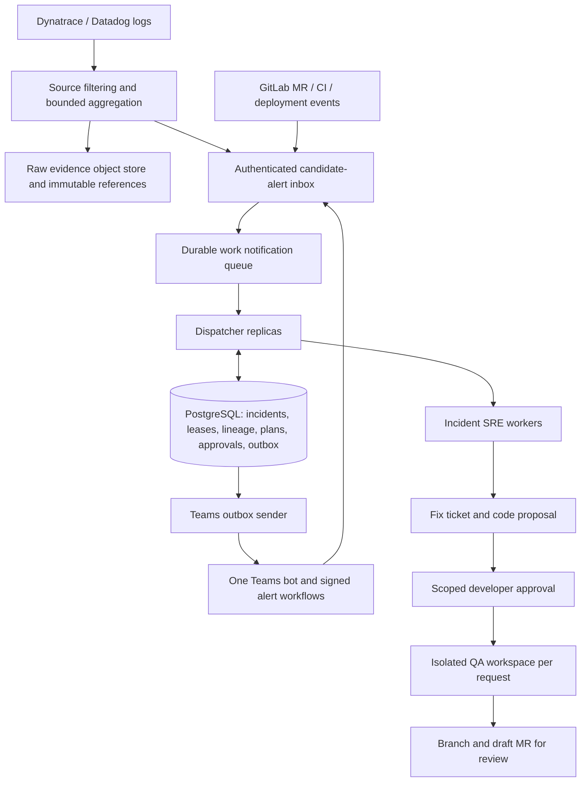

# Dispatch design for review

Status: **proposal, not implemented**. This document does not change the current single-investigator lease or deploy AWS resources. The existing runtime keeps one durable session per incident, a relational inbox/outbox and one investigator at a time. The new local QA fixture workflow is a bounded action workflow, not this proposed distributed dispatcher.

## Outcome

People address one SRE bot. Behind it, several dispatcher replicas route work to incident-specific SRE sessions and isolated QA runs. A conversation can follow an incident in several places without creating duplicate investigators or granting those places access to unrelated incidents. Different incidents progress concurrently. Evidence, state, ownership, approvals and delivery intent belong to the database, not a dispatcher process or a model's memory.

The dispatcher should be deterministic infrastructure. Use the model for evidence-backed investigation, not to decide queue ownership, access, deduplication or authorization.

## Intake and correlation

Keep raw logs out of model prompts and routine relational rows. Filter at the source by tenant, service/entity, environment and time. Retain rare error classes, severity changes, region/release distinctions, sample counts and coverage limits. Store compressed evidence pages in an object store with hash, source query, time window and retention metadata. SQL holds indexes and immutable references. An unavailable or partial reader remains unknown.

Authenticated vendor alerts become candidate incidents. A Teams workflow should mirror a structured alert directly to signed SRE ingress, including the original Teams channel/message identity. The agent can then reply to that alert's thread using an installed bot reference. Do not depend on one bot reading another bot's message or infer trust from a display name. Native Datadog/Dynatrace live acceptance is still needed.

Use an event key such as `(tenant, source, native_event_id)` with a payload digest. The same identity with different content is an error, not a second update. Record source observation time and receipt time separately. Delayed data can change an assessment but cannot silently overwrite newer lifecycle state.

Use a candidate grouping key `(tenant, service, environment, failure_family, bounded_time_window)` only when the inputs support it. A shared service, coincidental deployment or similar error text alone does not prove one cause. Different regions or release SHAs may need separate child incidents. Preserve a `related-to` edge rather than combining uncertain cases. Human review must authorize incident merge/split and reconcile conversation audiences. Keep original IDs as aliases and retain provenance.

## Multiple dispatchers and workers

1. Start with a fixed set of virtual partitions keyed by tenant and incident identity. Several dispatcher replicas claim partition leases in PostgreSQL. A replica may own many partitions; a crashed replica's lease can expire and be reassigned. Partition count and resharding are operational configuration, not model output.
2. Each incident also has a monotonically increasing fencing epoch and a renewable worker lease. Every state publication, QA authorization and outbox enqueue checks the epoch and incident revision in the same transaction. A delayed old worker cannot publish after a replacement takes over.
3. The queue carries work notifications and IDs. The SQL inbox is authoritative. A missing notification is repaired by a reconciliation scan; an extra notification cannot create another action. Acknowledge queue work after durable state transitions.
4. Allow different incident leases concurrently, with tenant, provider and model concurrency budgets. Keep one active SRE writer per incident. Read-only specialist work can return immutable findings to that writer; it cannot independently approve actions or broadcast conclusions.
5. Reserve capacity for new high-impact incidents and human questions. Do not let a large log storm, one tenant or repeated low-priority investigation consume every worker. Apply queue-age deadlines, bounded retries and explicit exhausted-work states.
6. Keep QA in separate workspaces with pinned base/head SHAs and short-lived repository credentials. Serialize conflicting repository/target-branch writes. Store the patch, test result, branch and MR IDs with their request. A moving head invalidates approval. A timed-out push or MR creation is `unknown` until reconciled by request identity; never blindly repeat it.

Amazon SQS FIFO is one possible notification transport: ordering is per message group, so an incident can be a group while different incidents progress independently. It does not replace SQL idempotency or worker fencing. AWS documents partitioning and high-throughput FIFO behavior; actual regional quotas, workload shape and chosen service limits must be checked before provisioning. [FIFO delivery logic](https://docs.aws.amazon.com/AWSSimpleQueueService/latest/SQSDeveloperGuide/FIFO-queues-understanding-logic.html), [high-throughput FIFO](https://docs.aws.amazon.com/AWSSimpleQueueService/latest/SQSDeveloperGuide/high-throughput-fifo.html).

## Many people and places

The incident is the shared unit; the Teams thread is a view and source of attributed reports. Keep sender identity, time, origin conversation and message ID. Fair context windows must balance rooms **and people**, retain explicit work/theory ledgers and indicate omitted history. Acknowledging a briefing means receipt, not agreement or recovery.

The current runtime now separates direct assessment answers from compact peer updates. Unchanged questions do not broadcast a full assessment to every room; changed judgments and required alert-thread replies remain durable. Bounded notices retain critical samples, handoff warnings and explicit omissions while the full assessment stays in SQL. Contact rendering is refreshed at delivery with its original/audit retained. This notification change does not add dispatcher replicas, worker partitions or extra investigator concurrency.

Keep current positions keyed by incident, participant and shared task/theory identity, with conversation provenance retained. Two people in the same chat can be separate owners or hold conflicting theories. One person repeating a claim in several chats is one participant. A later position can supersede that person's earlier claim only within the incident's authorized audience; it cannot cancel a colleague's work. The current offline coordinator now projects these positions from its existing relational report history. It also derives handoffs before per-room display limits: only current owner/completion reports ordered after the latest release can address that request, with explicit bounded coverage and source lineage. Older ownership and a briefing acknowledgement cannot accept a later handoff. This does not implement dispatcher replicas or additional investigator concurrency.

Do not automatically invite a group, create a chat, fetch history or widen an audience. Recommend the missing team and the evidence needed from it. A permitted participant can bring the bot into another conversation and join the same incident. An eight-room bound exists in the current runtime; beyond it, direct people to a common incident bridge rather than silently dropping rooms.

Background discussion requires scoped consent and installation. Microsoft's RSC permissions are `ChannelMessage.Read.Group` and `ChatMessage.Read.Chat`. The current live organization trial is mention-only. A future opt-in profile must name the allowed resources and retention, test uninstall/revocation and avoid unrelated organization chat. [Microsoft receive-all-messages documentation](https://learn.microsoft.com/en-us/microsoftteams/platform/bots/how-to/conversations/channel-messages-for-bots-and-agents).

Drawings and attachments need a separate content pipeline: authorized retrieval, format/size limits, source/message linkage and OCR/vision with uncertainty. An image is evidence, never an instruction or an approval. A whiteboard link is not its contents. This remains a proposed capability; the current rules-mode agent does not read drawings, voice or image attachments.

## Ownership and remediation

Combine service ownership, repository path ownership, CMDB relationships, current on-call roster and explicit escalation policy. Record directory version, validity window, reason and evidence for each recommendation. A commit author, manager or person speaking in a chat is not automatically the responder. Missing, expired or conflicting directory data must produce an ownership question.

The allowed ServiceNow read tools can supply CI context/relationships and user/group records when Ally grants access. They do not grant ticket creation, paging, repository writes or a current rota. Separate access is needed for the rota and authorized GitLab branch/MR operations. The agent can still save a Markdown ticket without ServiceNow/Jira writes.

Production codebase skills and special tooling should be an operator-approved, versioned bundle mounted into the isolated runner. Record its version/hash with each plan and QA run. Repository prose cannot expand permissions. That bundle is not available in this rehearsal.

The workflow is: investigate → cite evidence → recommend contacts → draft Markdown ticket → review exact proposed change → authorize QA → reproduce defect → apply patch in isolation → validate → publish branch/draft MR → human review. Rollback follows its separate artifact/compatibility/recovery policy. Never interpret a generic "yes" as approval for several pending actions; bind it to one reviewed request, developer, incident, conversation, revision and expiry. Model text and passive chat never authorize execution.

## Database boundary and AWS path

Keep the application contract `query`, `transaction`, `close`, plus domain repositories. SQLite remains the local profile; PostgreSQL is the shared production target. The current tables already persist events, evidence, sessions, jobs, source states, changes, directory snapshots, plans, QA request transitions, conversations, receipts and notification intents. Do not replace relational transactions with an object store or assume a generic key-value database is interchangeable.

An AWS implementation could use ECS services for ingress/dispatch/workers, RDS PostgreSQL for state, SQS for notifications, S3 for large evidence and artifacts, and Secrets Manager for scoped credentials. These are proposed choices, not validated infrastructure. RDS failover requires reconnection and in-flight transaction recovery; multi-AZ availability does not make an uncertain external write safe to retry. [AWS RDS connection guidance](https://docs.aws.amazon.com/AmazonRDS/latest/UserGuide/CHAP_CommonTasks.Connect.html), [RDS failover behavior](https://docs.aws.amazon.com/AmazonRDS/latest/UserGuide/multi-az-db-clusters-concepts-failover.html).

Schema migration, TLS/IAM, backup/PITR, retention/deletion, object-store integrity, restore fencing and cross-host clock behavior need explicit acceptance. A database URL change selects the PostgreSQL adapter; it does not itself perform data migration or establish AWS readiness.

## Ten million: sizing assumptions to resolve

"Ten million" needs a time unit and a distinction between log records, alert notifications and distinct incidents. These figures are arithmetic, **not measured capacity**:

| Input volume | Average ingress | Example 10× burst |
| --- | ---: | ---: |
| 10 million records/day | 116/s | 1,158/s |
| 10 million records/hour | 2,778/s | 27,778/s |
| 10 million records/minute | 166,667/s | 1,666,667/s |

For illustration only, reducing 10 million records/day to 10,000 distinct investigation turns/day gives 0.116 turns/s. At 90 seconds/turn and 70% target utilization, `ceil(arrival_rate × mean_duration / utilization)` gives about **15 active investigation slots**. That reduction ratio, duration and utilization are assumptions to measure. Ten million distinct incidents/day is a radically different workload and should not be promised on this architecture without a benchmark.

Measure ingestion p50/p95/p99, queue age, distinct incident creation, coalescing ratio, fairness, model/tool latency, read/write amplification, per-tenant spend, false positives/negatives and unknown-action rate. Use provider rate limits and model capacity as constraints. Store bounded samples and durable provenance rather than sending every record to a model.

## Acceptance before implementation/promotion

- Replay held-out healthy, code, dependency and schema incidents; measure detection quality and attribution abstention.
- Run at least two real dispatcher processes and several SRE workers; kill the owner during claim, tool read, result commit and send. Prove stale epochs cannot publish or duplicate an action.
- Exercise same incident from multiple rooms and people, many simultaneous incidents, contradictory reports, quiet participants, missed updates and access revocation.
- Crash the database and test reconnect, backup restoration and lost-interval external-effect reconciliation.
- Load test each volume scenario with explicit record size, duration, burst and tenant distribution. Include hot keys, provider 429s and a silent/slow tenant. No throughput claim until it is measured.
- Verify actual Teams RSC, original alert-thread replies, GitLab branches/MRs, model behavior and independently attested recovery in dedicated sandboxes.

Suggested implementation order after review: (1) per-incident fenced leases in the existing database queue; (2) tenant/provider budgets and multi-process acceptance; (3) outbox notifications to SQS; (4) partitioned dispatcher ownership and reconciliation; (5) measured scale expansion. Keep one bot identity throughout.

Provider alert behavior also varies: Datadog documents native Teams and Microsoft Workflows paths with different capabilities. Verify the exact tenant workflow rather than assuming all alert cards behave alike. [Datadog Teams integration](https://docs.datadoghq.com/integrations/microsoft-teams/).
