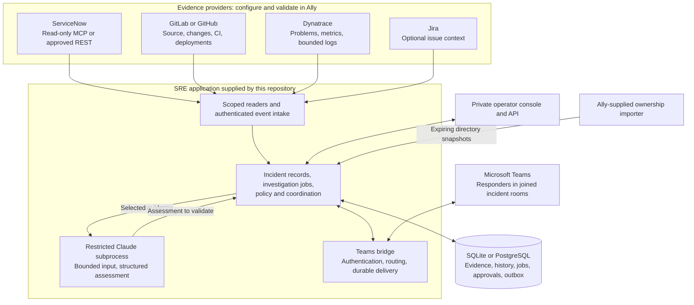
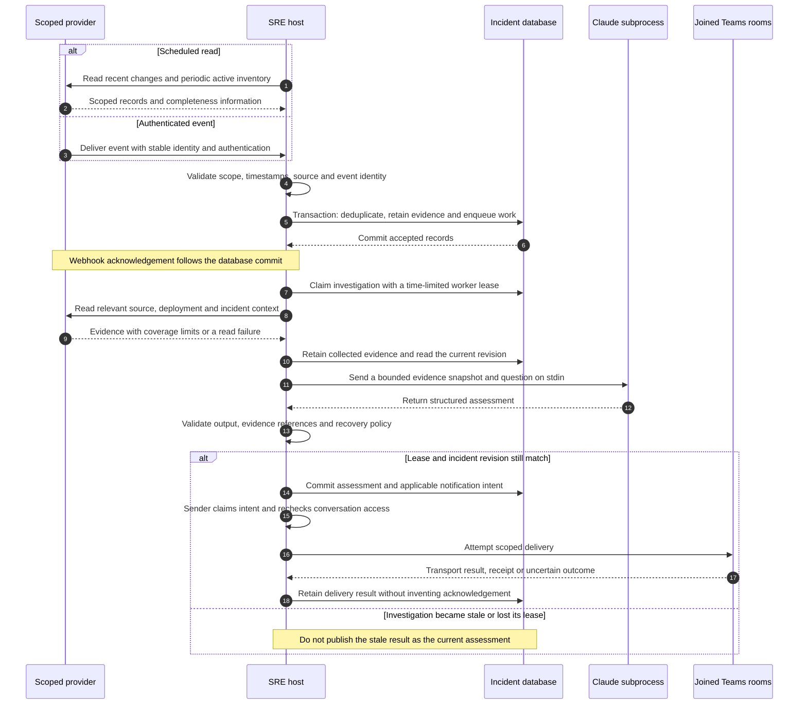
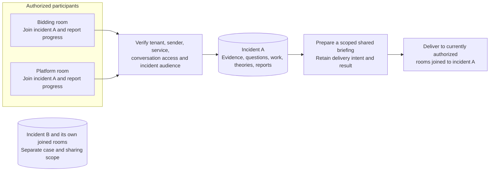
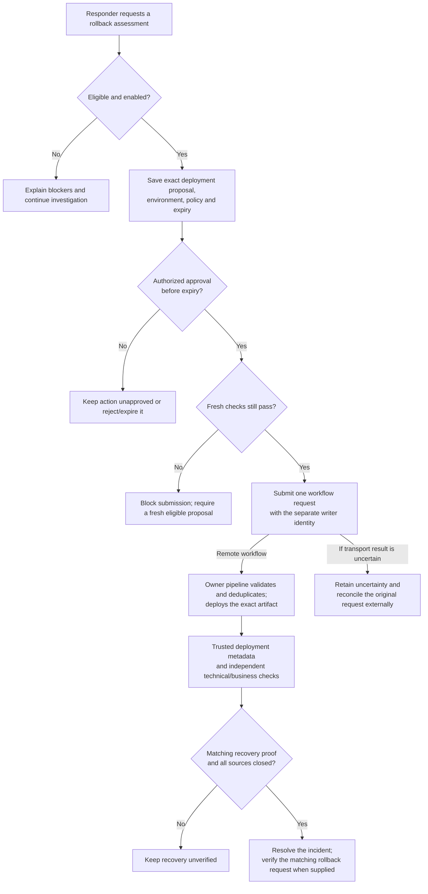

# How the SRE agent works

This guide is for responders, developers, platform owners, and coding agents who need to understand the system before operating or integrating it. Start here for the explanation; use the [Ally handoff](ALLY-HANDOFF.md) for setup, the [integration checklist](ALLY-INTEGRATION-CHECKLIST.md) for access/contracts, and the [architecture map](ARCHITECTURE.md) to find the implementation.

The service gathers evidence about a problem, keeps a shared incident record, investigates possible causes, and helps responders coordinate in Microsoft Teams. It can propose recovery when the evidence and policy allow it. People and protected deployment systems retain authority over real changes.

The default checkout is an offline demonstration with fictional auction data. The diagrams describe the connected design and explicitly configured optional features. They do not mean the required Ally services are already connected. Each diagram is editable Mermaid source in a fenced `mermaid` block in this Markdown file.

## The three different agents and services

| Name used in this project | What it means |
| --- | --- |
| SRE service / incident agent | The continuously running Node.js application in this repo. It owns evidence collection, incident records, Teams routing, policy checks, and optional workflow dispatch. |
| Claude investigation runtime | A restricted `claude -p` subprocess invoked by the SRE service. It receives selected evidence and returns a structured assessment. It has no direct vendor tools or deployment authority. |
| Claude Code or another coding agent implementing the project | The developer's assistant editing and testing this repository in an approved engineering environment. It uses [AGENTS.md](../AGENTS.md), [CLAUDE.md](../CLAUDE.md), and the [implementation brief](ALLY-AGENT-PROMPT.md). Its engineering access is separate from the running SRE service's identities. |

The offline rules reasoner substitutes a small set of known auction-defect checks for model inference. It makes the demonstration reproducible; general investigation quality needs separate Claude evaluation.

| Diagram term | Plain-language meaning |
| --- | --- |
| Evidence | A retained source observation or attributed report, including its origin and limits. It may support or contradict an explanation. |
| Incident revision | A version of the case's evidence. A result prepared for an older revision may need review before it can be treated as current. |
| Worker lease | A time-limited claim to perform a job. An expired worker cannot publish over its replacement. |
| Outbox / delivery intent | A durable record of a message the system intends to send, separate from the external transport result. |
| Artifact | The exact built release, identified by an immutable digest, rather than a branch that can change. |
| Independent health proof | Fresh measured technical and business checks from the trusted verifier, tied to the actual deployment. |

## 1. What connects to what

The host service sits between evidence providers and people. It collects records through scoped readers or authenticated events, stores them durably, and prepares an investigation. Its restricted Claude process sees a bounded snapshot. Teams and the operator console show the resulting evidence and assessment.



The boxes inside **SRE application** are implemented software. The external boxes require the approved endpoint, identity, resource mapping, network route, and acceptance checks. The database also needs suitable durable hosting. The supplied container needs Claude added through approved packaging if Claude reasoning is selected.

The incident database is the shared memory. Restarting the model process does not erase the incident. Model prompts, a developer's chat, and machine-local Claude transcripts are not the authoritative store.

Identity is checked at each boundary. Teams uses native Microsoft authentication and scoped conversation access. The current connected operator API uses a shared bearer token across its configured services; individual operator SSO/RBAC is not implemented by that token. Provider readers and the optional deployment writer use separate configured credentials, which are not handed to the restricted model subprocess.

Optional deployment execution has a separate diagram below. GitLab/GitHub **reads** in this diagram do not grant code publication, merge, or deployment rights. ServiceNow MCP stays behind the host-owned read boundary; it is not attached directly to Claude.

## 2. What happens during one investigation

An incident can start from an enabled monitoring/incident reader or an authenticated event. The service records the observation and investigation work together. A worker then gathers more context, asks the configured reasoner, and publishes only while its ownership and incident revision remain valid.



In offline mode the rules reasoner replaces the Claude step. Collection and model calls have limits; a missing record, expired credential, incomplete page, or sampled query stays an explicit limitation. An empty result does not automatically establish health or visibility into the entire tenant.

An assessment can say what is observed, which cause is plausible, what contradicts it, and which checks should come next. New evidence may make a saved assessment historical until another investigation completes. A source change, a green CI job, a merge, a deployment, and verified recovery are separate observations.

For example, fictional bidding errors after a release cause the service to compare actual source revisions and runtime evidence. A similar error on the earlier release is counterevidence to a simple release-only explanation. The system should retain that uncertainty instead of claiming that timing proves causality. See [attribution](ATTRIBUTION.md) for the code and evidence limits.

## 3. How several teams work on the same incident

Teams conversations are entry points into a durable case. They share context only through an authorized incident audience and an explicit incident binding. Installing the bot alone does not join a room to an incident.



The standalone **Incident B** box has no sharing arrow to incident A. Cross-incident information is not copied merely because the same person participates in both cases. Room names are descriptive; they do not grant access. Leaving, removal, or lost access affects future delivery eligibility. See [Teams coordination](TEAMS-COORDINATION.md) and [tenant-wide admission](TEAMS-ORGANIZATION.md#configuration-and-boundaries) for the exact rules and optional organization profile.

In a configured Teams pilot, select the real bot from the mention picker and begin with these commands. The offline console's Teams simulator exercises fictional identities separately.

| Responder goal | Command or action | Meaning |
| --- | --- | --- |
| Find the case | `incidents` | List incidents visible through this service's conversation scope |
| Join the discussion | `join <incident-id>` | Bind this conversation/thread to the incident |
| Report work | `update <what was done and observed>` | Retain an attributed responder report |
| Understand current evidence | `status`, `signals`, `changes` | Read the current assessment, grouped signals, or tracked changes |
| Find relevant people | `contacts` | Read owner/on-call candidates and freshness limits |
| Read a proposed fix | `plan`, `tickets` | Review a current Markdown plan or saved ticket index |
| Stop receiving the case here | `leave` | Remove the room's active incident binding |

An update such as “restarted the service; errors remain” is a report with an author and time. It does not independently prove an action happened or that recovery succeeded. Briefing acknowledgements mean that a participant acknowledged that briefing; transport receipts alone do not prove a person read it. Overlapping work, conflicting theories, or competing recovery reports remain visible for responders to reconcile.

Contact recommendations come from imported ownership/on-call evidence with expiry and shift windows. A displayed name is not an automatic page, an accepted handoff, or approval authority. [Casework](CASEWORK.md) explains the directory and fix-plan records.

## 4. How a real recovery action is controlled

Investigation and recovery are different capabilities. The connected template starts with rollback disabled. When an authorized rollout later enables it, the host must first find an eligible exact target and produce a proposal. A configured approver must approve that proposal from an authorized conversation. The host rechecks current conditions before sending a deployment request.



Fresh checks include the worker lease, current assessment/evidence, exact current and target deployment, configured workflow/scope, and approval expiry. The authorized approval must refer to the exact proposal and come from the configured person and allowed conversation.

The diagram's two arrows after dispatch describe possible outcomes, not permission to submit twice. A workflow accepting a request does not establish that a deployment happened. A lost result can leave the outcome unknown; the original request ID must be reconciled before another action is considered. A verified no-change outcome has its own signed contract and can require a new proposal. See [workflow approval and uncertain outcomes](WORKFLOW-APPROVAL.md).

The protected application-specific pipeline, real release publisher, and independent health checker must be supplied and tested by the deployment owners. The repository supplies the receiving/dispatch contracts and local fixtures. The model cannot approve or execute a rollback. Recovery can also follow a separate human-led fix; the incident still needs the relevant source closures and independent health proof.

Accepted auction transactions may need business reconciliation even after service health improves. Redeploying an artifact does not undo accepted business events or make an incompatible migration safe.

## 5. What persists and what failures mean

| Situation | What the operator should understand |
| --- | --- |
| Normal service restart | Evidence, questions, assessment history, room bindings, jobs, approvals, and delivery records live in SQL. Work resumes under lease/current-policy checks; a Claude transcript is not needed to rebuild context. |
| Provider denies a read or returns incomplete data | The source needs attention. Previously saved evidence remains historical; denial or missing data does not mean healthy. |
| Model turn fails or times out | No valid new assessment is published. Bounded retries may exhaust; an operator can request an investigation retry with a reason. This is separate from replaying a deployment or message. |
| Teams send has an uncertain result | The database retains the uncertainty and any later evidence. A recipient may have received it. Do not infer acknowledgement or assume a resend is safe. |
| Database backup is restored | The snapshot can omit external effects that happened after the backup. Use the restore hold, reconcile that missing interval, and obtain fresh evidence before releasing affected operations. |
| Ownership snapshot expires | Current contact selection becomes uncertain even if an older assessment's code findings still apply. Refresh the directory rather than treating the old roster as current. |

Use the [operations guide](AGENT-OPERATIONS.md) for health and retry procedures, [backup/restore](BACKUP-RESTORE.md) for recovery holds, and [database transfer](DATABASE-TRANSFER.md) for an offline SQLite/PostgreSQL cutover. A successful `/health` response checks liveness/database access; it does not prove that every reader, investigation, or sender is progressing.

## 6. Try it and choose the next guide

With Node.js 24+, Git, and pnpm 11.25.0 installed through approved workstation tooling:

```sh
pnpm install --frozen-lockfile
pnpm sre:lab
```

Open `http://127.0.0.1:3001` and select a synthetic scenario. In another terminal, `pnpm sre:seed recent-regression` creates the same kind of fictional case. Use `pnpm sre:rehearsal` on port 3004 for the separate persisted multi-team walkthrough. These defaults need no vendor credentials or model inference.

For actual Claude development, install/authenticate the approved Claude CLI and run `pnpm sre:dev` on port 3010. It starts without seeded incidents and has no rules fallback. See [Claude development](CLAUDE-AGENT-DEVELOPMENT.md) and [sustained group evaluation](SUSTAINED-GROUP-EVALUATION.md) for model-backed investigations and current capacity limits.

For engineering changes run `pnpm test`. Its first-run fixture setup is included. The original auction website is a separate `pnpm dev` process on port 3000; the database-backed integration console is the port-3001 application described here.

| Next task | Guide |
| --- | --- |
| Integrate a scoped Ally pilot | [Ally developer handoff](ALLY-HANDOFF.md) |
| Obtain exact connectors, service identities, and contracts | [Integration checklist](ALLY-INTEGRATION-CHECKLIST.md) |
| Configure MCP, events, Teams, metrics, or a deployment workflow | [Integration contracts](INTEGRATIONS.md), [ServiceNow MCP](SERVICENOW-MCP.md), [Claude runtime](CLAUDE-RUNTIME.md) |
| Find the implementing code | [Architecture and source map](ARCHITECTURE.md) |
| Ask a coding agent to implement the integration | [Agent implementation brief](ALLY-AGENT-PROMPT.md) and [AGENTS.md](../AGENTS.md) |
| Understand what was verified for the shipped code | [Handoff verification](HANDOFF-VALIDATION.md); dated trial records retain their own scope |

Attach new acceptance evidence to the actual Ally environment and tested resources. The synthetic walkthrough and historical external trial reports do not establish current Ally access or production readiness.
