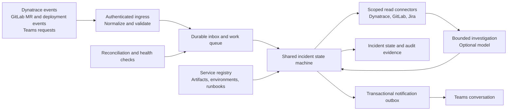

> Initial architecture review. Implementation status has advanced; use [README.md](../README.md) and [INTEGRATIONS.md](INTEGRATIONS.md) for current behavior.

# Review of the SRE agent plan

The event-driven direction is sound. The biggest correction is to separate incident correctness, model reasoning, transport, and execution permissions so the same decisions can be tested locally and deployed on AWS.

Scope: SRE investigation and recovery guidance for a smart-auction service. Jira supplies read-only ticket context. The agent does not implement features or manage Jira.

## Findings and changes

| Priority | Issue | Required change |
| --- | --- | --- |
| High | A merge is not proof of a deployment. Reviewing only after merge also misses the opportunity to catch a risk before release. | Review MR changes before merge; separately consume successful deployment events and watch the actual deployed artifact. Bind the review to the full commit SHA and invalidate it when the MR changes. |
| High | “A deployment happened before the alert” is correlation, not root cause. | Match service, environment, tenant, region/cell, artifact, and time. Compare telemetry and known failure signatures. Keep alternative hypotheses, including provider failure and unrelated changes. |
| High | Rolling back an application may fail after a migration or leave corrupted auction state. | Record immutable artifacts, schema and feature-flag compatibility, last verified healthy deployment, and the exact runbook. In the first release, provide an operator-reviewed recovery proposal. Require reconciliation of affected bids, winners, and downstream settlement state. |
| High | Step Functions, the agent framework, and an incident database can accidentally become three competing workflow owners. | Make the incident state machine authoritative. Treat model investigation as a bounded activity. Choose one owner for leases, retries, and scheduling. Avoid wrapping every model/tool step in a second workflow engine. |
| High | Local emulation cannot establish production parity. | Test shared business decisions directly. Test AWS transport and failure behavior through adapters, then run a small real AWS smoke test before production. |
| High | A functioning chat simulator does not prove a Teams installation works. | Test the real SDK locally, then authenticate a bot in a dedicated tenant/channel over an HTTPS tunnel. Verify installation, channel scopes, mention behavior, proactive delivery, and permission failures. |
| High | Always-on LLM polling is expensive and unreliable as the primary detector. | Use Dynatrace events and deterministic alert/SLO rules to trigger bounded investigations. Reconcile missed events with scheduled reads. Invoke a model when new evidence warrants it, not for every sample. |
| High | Default agent tools and untrusted logs/diffs can give a diagnostic agent unintended execution authority. | Disable generic write/shell tools. Treat Jira, diffs, logs, and messages as evidence, not instructions. Expose typed, scoped read tools. Any future recovery executor has separate credentials and explicit authorization. |
| Medium | Webhooks are duplicated, delayed, sometimes missed, and may arrive out of order. | Use an inbox with durable idempotency, source timestamps and versions, reconciliation checkpoints, bounded retry/backoff, and a dead-letter queue. Order by logical incident state rather than arrival time alone. |
| Medium | Persisting an incident and then sending a chat message can lose or duplicate notifications on a crash. | Write incident changes and an outbox record in one transaction. Deliver asynchronously; preserve remote message/thread IDs. Design for at-least-once delivery and reconciliation, not an exactly-once claim. |
| Medium | “GitLab/Jira/Dynatrace connector” is underspecified. | Confirm GitLab version/hosting, Jira Cloud versus Data Center, Dynatrace Classic versus Grail, scopes, region, rate limits, retention, and data access. Test real payloads and incomplete result handling. |
| Medium | A handful of known scenarios can make scripted or model accuracy look better than it is. | Keep deterministic workflow tests separate from held-out reasoning evaluations. Include healthy releases, unrelated deployments, missing evidence, new failure patterns, and adversarial text. Never pass expected answers to the investigator. |
| Medium | Idle infrastructure can cost money before there are incidents. | Defer production provisioning. Estimate the selected region's queue, compute, database, network, logs, model, and telemetry-query costs after the workload is measured. Include ALB/NAT/RDS/Fargate baseline costs if chosen. |

GitLab documents distinct MR, pipeline, and deployment events. The production design must preserve those distinctions. [GitLab webhook events](https://docs.gitlab.com/user/project/integrations/webhook_events/)

AWS explicitly marks Step Functions Local unsupported and says it lacks feature parity. `TestState` is an AWS API, not an offline substitute. This is why the core transition logic lives in ordinary code. [AWS testing guidance](https://docs.aws.amazon.com/step-functions/latest/dg/test-and-debug.html)

## Revised architecture

The lab implements the decision core and simplified local persistence. It tests SQS batch dispatch against that core. Authenticated vendor webhook ingress, scalable persistence, leases, reconciliation, and proactive delivery remain production work.

For the first AWS pilot, use a small ingress service, SQS plus a DLQ, one worker path, a durable state store, Secrets Manager, and CloudWatch. A short bounded worker may use Lambda; a longer investigation worker may use ECS Fargate. Choose from measured execution time. Start with one approach and introduce Step Functions only where its durable orchestration is clearly needed.

The optional Eve integration is an evaluation adapter. The installed Eve documentation identifies the framework as preview. Keep its version pinned, keep incident state outside it, and evaluate restart behavior and AWS operation before selecting it for production. Its presence in this repository is not a decision to host on Vercel.

## Smart Auction-specific correctness

HTTP availability alone is insufficient. Monitor accepted bids against auction rules:

- A confirmed winning amount cannot fall because of a later concurrent write.
- Repeated submissions with the same idempotency key cannot create another bid; a different payload with the same key must be rejected.
- Close-time and extension rules use an authoritative clock and remain correct across retries and slow dependencies.
- Credit/eligibility timeout or unavailability has an explicit operational outcome, rather than silently changing auction rules.
- Bidding, auction close, winner selection, and settlement retain an auditable event history and reconciliation process.
- A successful rollback verifies both technical health and business invariants. Already incorrect transactions need their own recovery procedure.

The lab covers a subset: concurrent writes, idempotency, closing time, provider errors, schema expectations, and latency. Production auction extension rules, multi-instance locking, database isolation, settlement, regional failover, and real identity/eligibility policy need dedicated tests once the team's actual design is known.

## Decisions still needed before production implementation

Confirm the target GitLab/Jira/Dynatrace editions; Teams tenant and app-registration policies; actual auction service boundaries and deployment method; approved model/data handling; on-call channel routing; and rollback/runbook ownership. None of these require guessing or committing AWS spend to make progress on the local lab.
