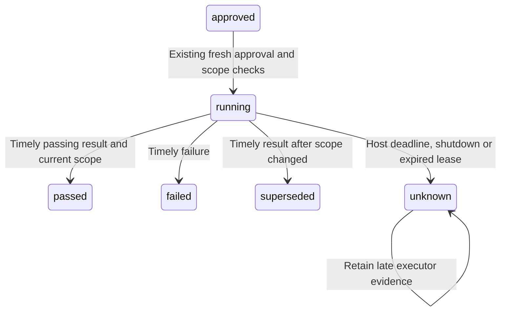

# Local QA execution and cancellation

The QA path remains a trusted local fixture workflow. It can correct one supported auction policy defect, reproduce the original failure, run four business checks and commit a local proposal branch. It does not provide a general code executor, push a branch, create a remote MR, merge or deploy. Real Claude diagnosis and an enterprise isolated runner need separate acceptance.

The host bounds its wait for `qaAdapter.execute({requestId, plan, markdown, signal})`. The default deadline is 90 seconds, within the existing 120-second durable execution lease. Trusted runtime construction can set `qaOptions.timeoutMs` from 1 to 90000; source files, model output and chat cannot select it. The known fixture forwards the host signal to Git, test subprocesses and file writes and checks an already cancelled request before creating its workspace.

A deadline or shutdown requests cancellation and records **unknown**, because a workspace or commit may already exist. A simultaneous evidence or authorization change cannot disguise that uncertainty as an ordinary superseded result. The request is never automatically replayed. Later results or errors are retained as `late-result` evidence while the host is open; they cannot promote the request to passing. After a crash or closed host, inspect the workspace and retained request before further work.

One unresolved QA call reserves one slot per runtime until the underlying promise actually settles, including an adapter that ignores abort. The automatic scheduler can continue read-only investigation while a submitted QA call is still healthy, before its deadline, and after cancellation. It cannot launch additional local QA or start a protected rollback in that instance while the call remains unresolved.

The existing one-second scheduler advances one investigator and one serial action chain separately. QA preflight/publication and protected rollback revalidation/dispatch defer a new investigator; only the submitted isolated QA call permits overlap. If a review is already running when QA finishes, protected dispatch waits for a later cycle. Command acknowledgements and delivery continue independently. The explicit `tick()` embedding helper remains a full-cycle barrier; `investigate()` and `actions()` expose the separately coalesced work. These are instance-local ordering rules with the existing SQL leases, not a distributed dispatcher or a cross-host writer guarantee. Investigation concurrency remains one.

Tickets and QA approval also check the reviewed assessment, because a refresh can change a conclusion without advancing its evidence revision. New tickets retain a hash of the summary, attribution, candidate, code/source findings, evidence references, unknowns and rollback assessment. Older tickets are compared using their retained facts. Drafting rejects a replaced assessment during asynchronous context reads; proposal, approval and execution reject a changed conclusion. A timely QA result becomes historical if the assessment changes while the call runs, even at the same revision. Deadline or shutdown uncertainty still remains **unknown**. The console warns about a changed assessment and disables QA for that ticket; its immutable Markdown remains readable.

Operations show the shared unknown QA request separately from `instance_qa_saturated`, which identifies a local slot held by an unresolved cancelled call. `instance_qa_audit` reports a failure to retain late evidence. An audit-write failure does not make the action passing or replayable. Inspect the saved request, plan, workspace and actual branch before deciding on a fresh request.

Runtime shutdown interrupts QA before draining active investigation and action work, records its unknown outcome before closing storage, and prevents a following deployment-execution phase. Cancellation is advisory: a trusted adapter must propagate it to its own subprocesses and stop starting further actions. The host cannot certify that an arbitrary external runner stopped from an abort signal alone.

Shutdown continues cleanup if a transport close or SQL worker-lease release fails. It still drains active work, closes each distinct provider client and closes storage. A single failure is returned unchanged; multiple failures are reported together. This does not retry an uncertain action or pretend a failed lease release succeeded. When storage is down, durable lease/outcome reconciliation still belongs to the next host after database recovery.

The existing approval, revision, conversation, restore and delivery checks still apply. SQL retains the original plan, request, transitions, result or uncertainty, peer notice and any late executor evidence. No schema, tenant permission, repository write credential or deployment authority is added.

Saved QA history reports the original execution state separately from its current assessment match. A later conclusion change can leave `status: passed` as an accurate local test observation while `assessment.state: changed` and `current: false` identify historical artifacts. Pending proposals/approvals receive their existing stale display labels. The console and Teams `qa` summaries explain the distinction; these reads never invalidate, approve, rerun or rewrite an action.

History extracts only the ticket's small retained assessment hash, not its Markdown or full payload. Legacy tickets without this hash remain readable with an unverified match; the separate action guard can still compare their full retained facts. Current assessment comparison requires an exact audited body at the current/latest revision. It reads at most 524288 characters and 512000 UTF-8 bytes; missing, unaudited, outdated or larger bodies remain explicitly unverified. An opaque `assessmentVersion` changes when these reviewed facts or verification state change. It lets an open inspection or cached history page show that its observation predates a same-revision update. The version is a cache observation, not approval authority or a claim of production recovery.
